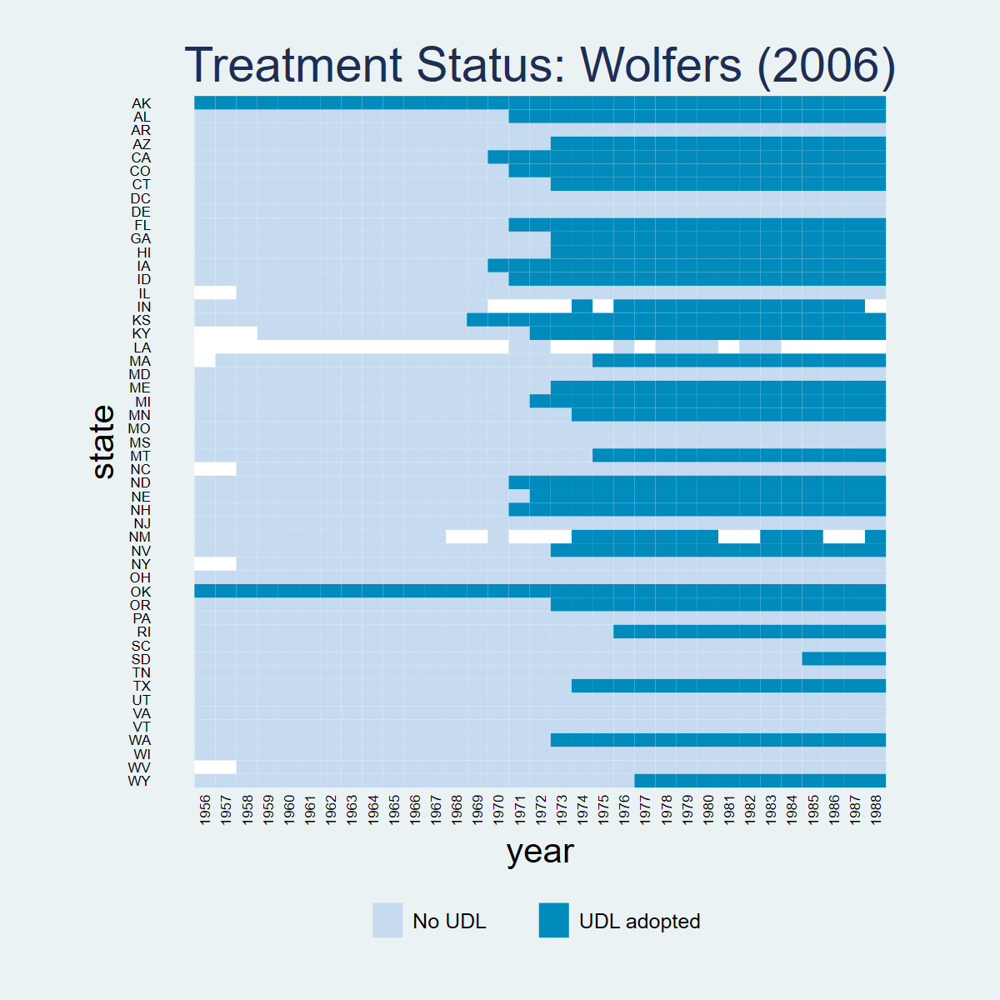
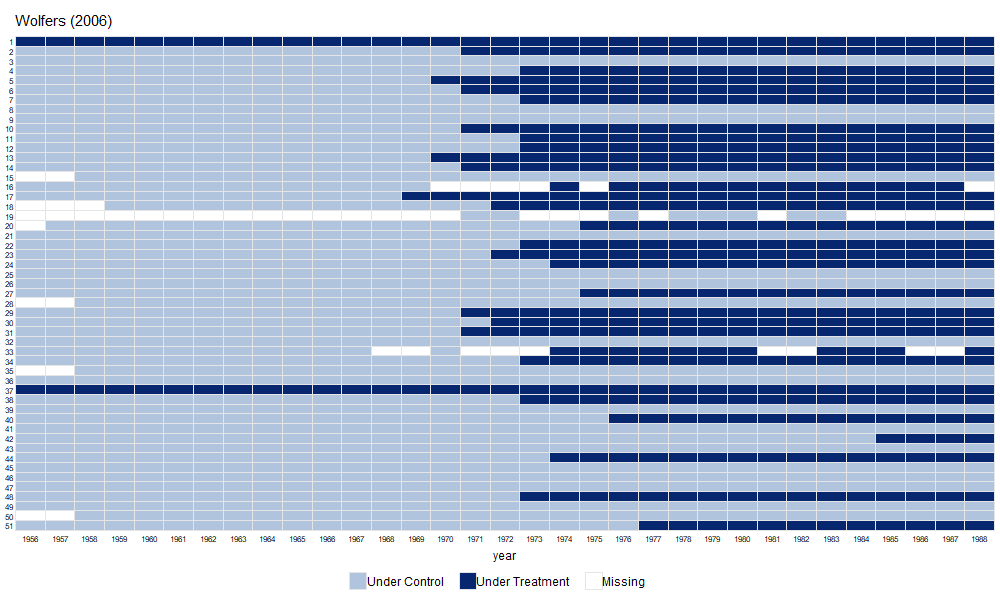
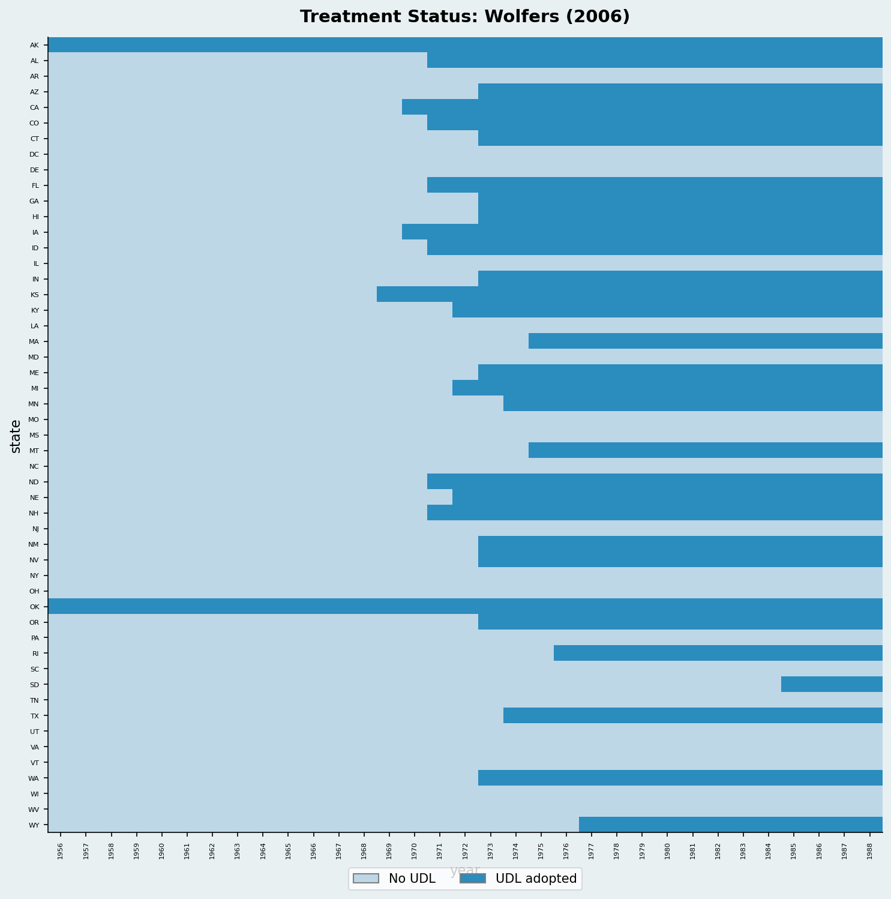
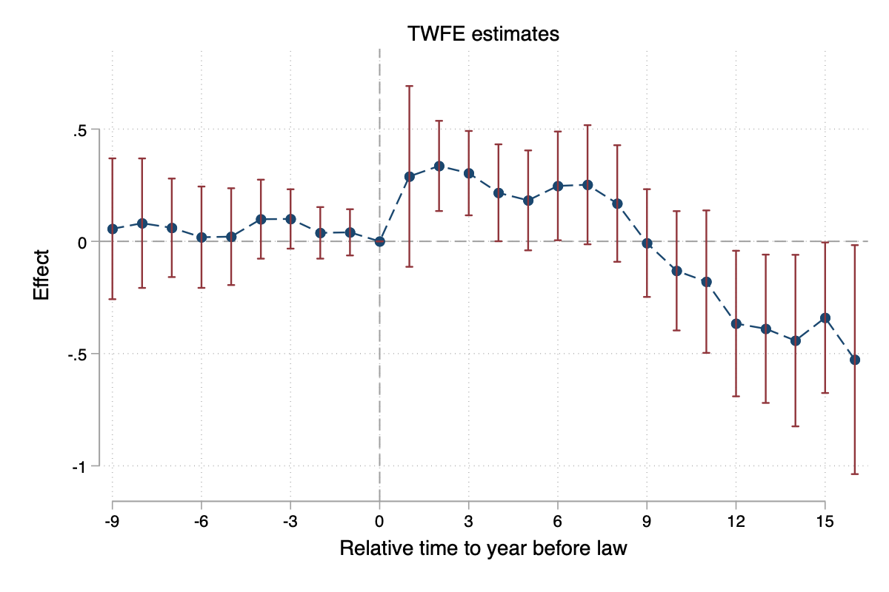
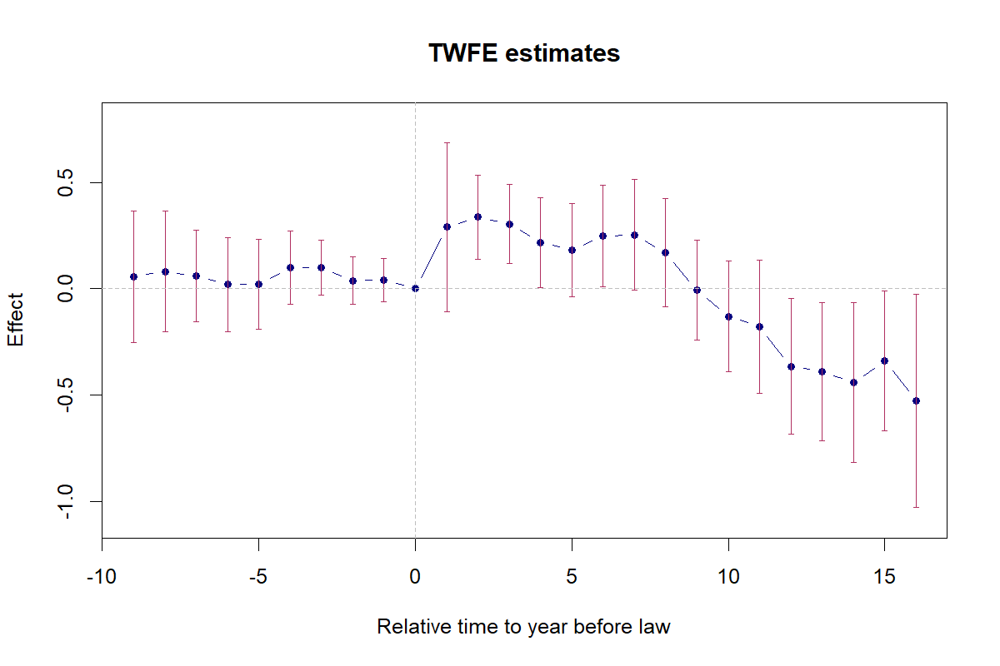
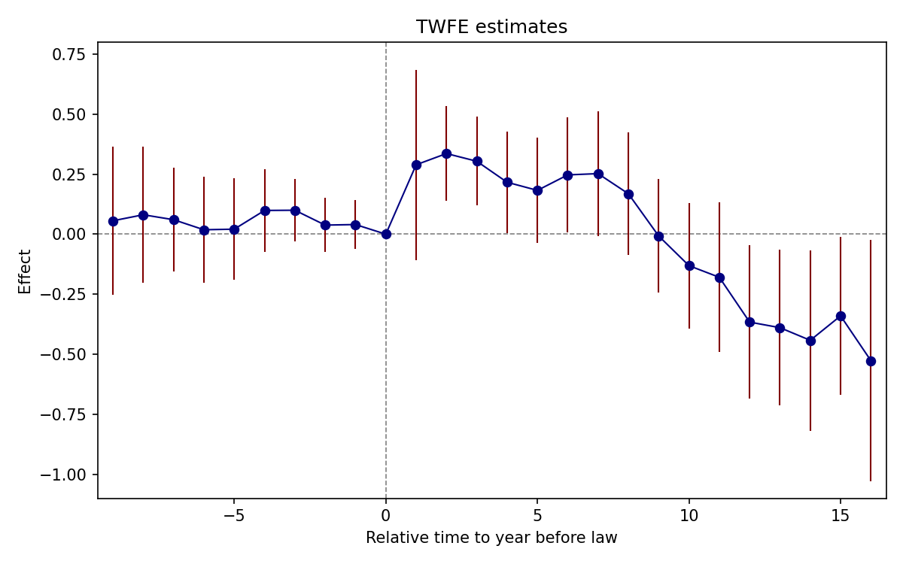
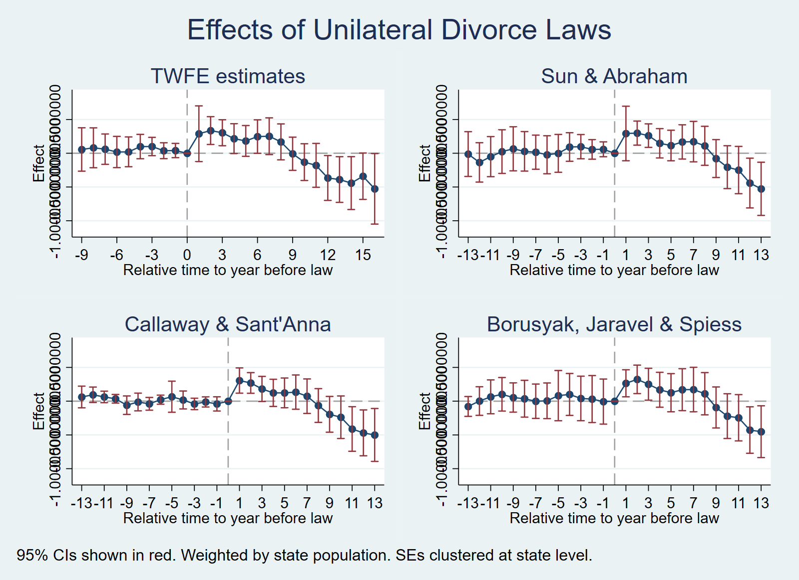
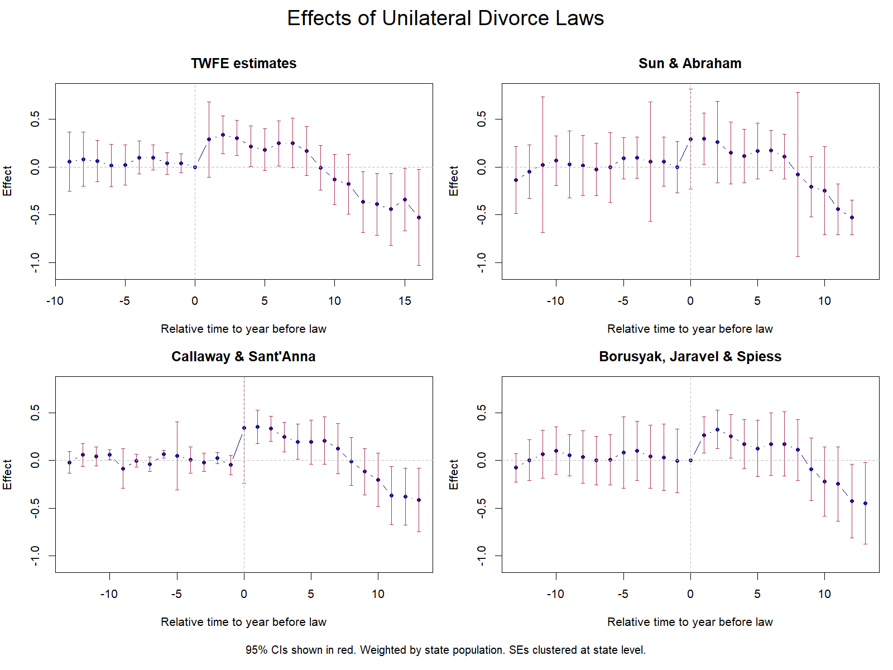
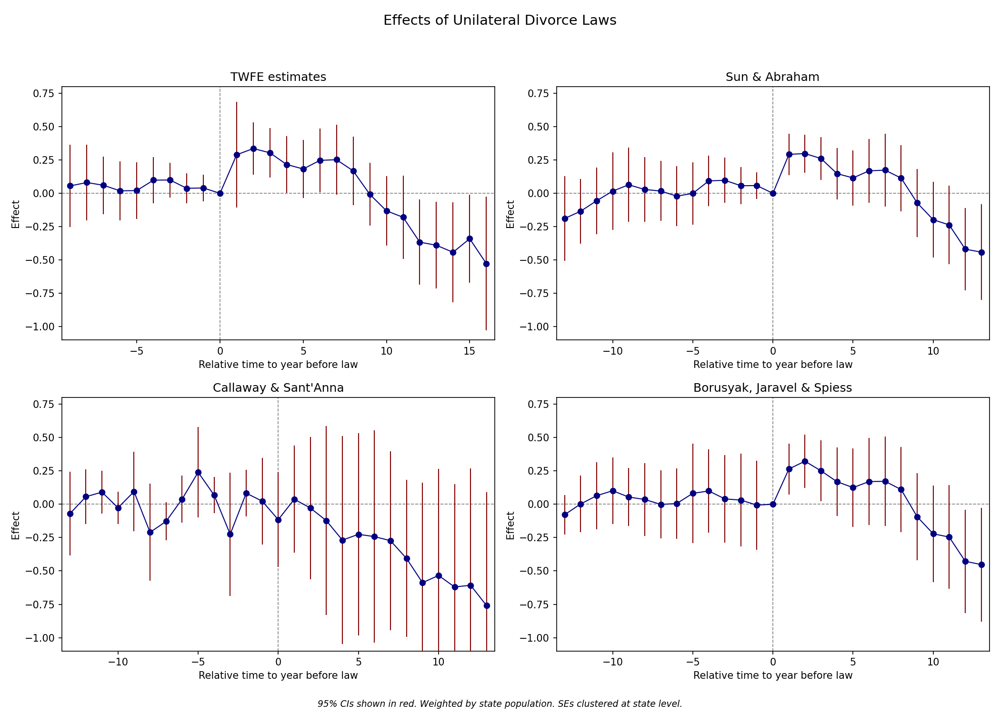

## Overview {.unnumbered}

Dataset: **Wolfers (2006)** — `wolfers2006_didtextbook.dta(Stata), wolfers2006_didtextbook.RData (R), wolfers2006_didtextbook.parquet (Python)`

This chapter analyzes the effect of unilateral divorce laws (UDL) on divorce rates using a binary-and-staggered design. Between 1968 and 1988, 29 US states adopted UDLs. The panel covers 51 states from 1956 to 1988, with population weights and state-clustered standard errors throughout.

Key topics: decomposition of the static TWFE estimator, event-study TWFE, and four heterogeneity-robust estimators (Sun & Abraham, Callaway & Sant'Anna, de Chaisemartin & D'Haultfœuille, Borusyak et al.).

------------------------------------------------------------------------

## PanelView {.unnumbered}

::: panel-tabset
### Stata



``` stata
* ssc install panelview, replace
copy "https://raw.githubusercontent.com/Credible-Answers/did_book/main/cc_xd_didtextbook_2025_9_30/Data%20sets/Wolfers%202006/wolfers2006_didtextbook.dta" "wolfers2006_didtextbook.dta", replace
use "wolfers2006_didtextbook.dta", clear
panelview div_rate udl, i(state) t(year) type(treat) title("Treatment Status: Wolfers (2006)") legend(label(1 "No UDL") label(2 "UDL adopted"))
```

### R

``` r
library(panelView)
load(url("https://raw.githubusercontent.com/Credible-Answers/did_book/main/cc_xd_didtextbook_2025_9_30/Data%20sets/Wolfers%202006/wolfers2006_didtextbook.RData"))
df <- haven::zap_labels(df)
df <- as.data.frame(df)

p <- panelview(div_rate ~ udl, data = df, index = c("state", "year"), type = "treat",
               main = "Wolfers (2006)", ylab = "")
print(p)   # lo muestra en Plots

dir.create("figures", showWarnings = FALSE)
png("figures/ch06_panelview_R.png", width = 1000, height = 600)
print(p)   
dev.off()
```



### Python



``` python
import pandas as pd
import matplotlib.pyplot as plt
import matplotlib.colors as mcolors
from matplotlib.patches import Patch
df = pd.read_parquet("https://raw.githubusercontent.com/Credible-Answers/did_book/main/cc_xd_didtextbook_2025_9_30/Data%20sets/Wolfers%202006/wolfers2006_didtextbook.parquet")
states_sorted = (df.groupby("state")["cohort"]
                 .first().sort_values(ascending=False).index)
state_idx = {s: i for i, s in enumerate(states_sorted)}
years = sorted(df["year"].unique())

fig, ax = plt.subplots(figsize=(14, 10))
cmap = mcolors.ListedColormap(["#4292C6", "#EF6548"])
for _, row in df.iterrows():
    si = state_idx[row["state"]]
    yi = years.index(row["year"])
    color = 1 if row["udl"] == 1 else 0
    ax.add_patch(plt.Rectangle((yi, si), 1, 1, color=cmap(color)))

ax.set_xlim(0, len(years)); ax.set_ylim(0, len(states_sorted))
ax.set_xticks(range(0, len(years), 5))
ax.set_xticklabels([str(int(years[i])) for i in range(0, len(years), 5)],
                    rotation=45, fontsize=7)
ax.set_yticks([i + 0.5 for i in range(len(states_sorted))])
ax.set_yticklabels(states_sorted, fontsize=6)
ax.set_xlabel("Year"); ax.set_ylabel("State")
ax.set_title("Treatment Status: Wolfers (2006)")
legend_elements = [Patch(facecolor="#4292C6", label="Control"),
                   Patch(facecolor="#EF6548", label="Treated")]
ax.legend(handles=legend_elements, loc="lower right")
plt.tight_layout()
plt.savefig(FIGDIR / "ch06_panelview_Python.png", dpi=150)
```
:::

------------------------------------------------------------------------

## CQ#25: Static TWFE Regression

> Run the static TWFE regression of `div_rate` on state and year FEs and the UDL treatment, weighting by population and clustering at the state level. Do UDLs have an effect on divorces?

::: panel-tabset
### Stata

``` stata
copy "https://raw.githubusercontent.com/Credible-Answers/did_book/main/cc_xd_didtextbook_2025_9_30/Data%20sets/Wolfers%202006/wolfers2006_didtextbook.dta" "wolfers2006_didtextbook.dta", replace
use "wolfers2006_didtextbook.dta", clear
reg div_rate udl i.state i.year [w=stpop], vce(cluster state)
```

```         
Linear regression                               Number of obs     =      1,631
                                                R-squared         =     0.9305
                                                Root MSE          =     .52417

                                 (Std. err. adjusted for 51 clusters in state)
------------------------------------------------------------------------------
             |               Robust
    div_rate | Coefficient  std. err.      t    P>|t|     [95% conf. interval]
-------------+----------------------------------------------------------------
         udl |  -.0548378   .1507695    -0.36   0.718    -.3576673    .2479917
------------------------------------------------------------------------------
```

### R

``` r
library(haven); library(fixest)
load(url("https://raw.githubusercontent.com/Credible-Answers/did_book/main/cc_xd_didtextbook_2025_9_30/Data%20sets/Wolfers%202006/wolfers2006_didtextbook.RData"))
m1 <- feols(div_rate ~ udl + i(year) | state,
            data = df, weights = ~stpop, cluster = ~state,
            ssc = ssc(fixef.K = "full"))
```

```         
Variable              Coefficient      Std. err.          t   [95% Conf. Interval]
------------------------------------------------------------------------------------------
udl                    -0.0548378      0.1507695      -0.36   [  -0.3503461,    0.2406705]

N = 1631  |  R-sq = 0.9305
```

### Python

``` python
import pandas as pd
import pyfixest as pf
df = pd.read_parquet("https://raw.githubusercontent.com/Credible-Answers/did_book/main/cc_xd_didtextbook_2025_9_30/Data%20sets/Wolfers%202006/wolfers2006_didtextbook.parquet")
m1 = pf.feols('div_rate ~ udl + i(year) | state',
              data=df, weights='stpop', vcov={'CRV1': 'state'},
              ssc=pf.ssc(adj=True, fixef_k='full', cluster_adj=True))
m1.summary(digits=7)
```

```         
| Coefficient   |   Estimate |   Std. Error |    t value |   Pr(>|t|) |       2.5% |      97.5% |
|:--------------|-----------:|-------------:|-----------:|-----------:|-----------:|-----------:|
| udl           | -0.0548378 |    0.1507695 | -0.3637192 |  0.7176012 | -0.3576673 |  0.2479917 |

RMSE: 1031.4486884 R2: 0.9304837 R2 Within: 0.8298766 
```
:::

**Interpretation:** $\hat{\beta}_{fe} = -0.055$ (s.e. = 0.15, p = 0.72). The coefficient is small and insignificant. According to this regression, UDLs do not affect divorce rates.

------------------------------------------------------------------------

## CQ#26: Decompose Static TWFE

> Decompose $\hat{\beta}_{fe}$ using `twowayfeweights`. Does it estimate a convex combination of effects? Could it be biased for the ATT?

::: panel-tabset
### Stata

``` stata
* ssc install twowayfeweights, replace
copy "https://raw.githubusercontent.com/Credible-Answers/did_book/main/cc_xd_didtextbook_2025_9_30/Data%20sets/Wolfers%202006/wolfers2006_didtextbook.dta" "wolfers2006_didtextbook.dta", replace
use "wolfers2006_didtextbook.dta", clear
twowayfeweights div_rate state year udl, type(feTR) test_random_weights(exposurelength) weight(stpop)
```

```         
Under the common trends assumption,
the TWFE coefficient beta, equal to -0.0548, estimates a weighted sum of 522 ATTs.
490 ATTs receive a positive weight, and 32 receive a negative weight.
------------------------------------------------
Treat. var: udl         # ATTs      Σ weights
------------------------------------------------
Positive weights        490         1.0259
Negative weights        32          -0.0259
------------------------------------------------
Total                   522         1.0000
------------------------------------------------

Regression of variables possibly correlated with the treatment effect on the weights

                     Coef           SE       t-stat  Correlation
exposurele~h   -8.2883613    .21360588    -38.80212   -.73253245
```

### R

``` r
library(haven); library(TwoWayFEWeights)
load(url("https://raw.githubusercontent.com/Credible-Answers/did_book/main/cc_xd_didtextbook_2025_9_30/Data%20sets/Wolfers%202006/wolfers2006_didtextbook.RData"))
decomp2 <- twowayfeweights(df, "div_rate", "state", "year", "udl",
                            type = "feTR",
                            test_random_weights = "exposurelength",
                            weights = df$stpop)
```

```         
Under the common trends assumption,
beta estimates a weighted sum of 522 ATTs.
490 ATTs receive a positive weight, and 32 receive a negative weight.

Treat. var: udl     ATTs    Σ weights
Positive weights     490       1.0259
Negative weights      32      -0.0259
Total                522            1

Regression:
                       Coef        SE    t-stat Correlation
RW_exposurelength -8.288361 0.2136059 -38.80212  -0.7325324
```

### Python

``` python
import pandas as pd
from twowayfeweights import twowayfeweights
df = pd.read_parquet("https://raw.githubusercontent.com/Credible-Answers/did_book/main/cc_xd_didtextbook_2025_9_30/Data%20sets/Wolfers%202006/wolfers2006_didtextbook.parquet")
result = twowayfeweights(df, "div_rate", "state", "year", "udl",
                          type="feTR", weights="stpop",
                          test_random_weights="exposurelength")
print(result)
```

```         
Under the common trends assumption,
beta estimates a weighted sum of 522 ATTs.
490 ATTs receive a positive weight, and 32 receive a negative weight.
Sum of positive weights: 1.0259
Sum of negative weights: -0.0259

Regression of variables possibly correlated with the treatment effect on the weights

                     Coef           SE       t-stat  Correlation
exposurelength   -8.288361     0.213606    -38.8021   -0.732532
```
:::

**Interpretation:** Under parallel trends, $\hat{\beta}_{fe}$ estimates a weighted sum of ATTs. The vast majority receive positive weights (sum ≈ 1.026) and 32 receive negative weights (sum ≈ −0.026), an "almost convex" combination. However, weights are strongly negatively correlated with exposure length (corr = −0.73, t = −38.8): $\hat{\beta}_{fe}$ heavily downweights long-run effects. It could differ from the ATT if treatment effects vary with length of exposure.

------------------------------------------------------------------------

## CQ#27: Test Randomized Treatment Timing

> Test whether pre-treatment outcomes differ across early, late, and never adopters (excluding always-treated states, restricting to years ≤ 1968).

::: panel-tabset
### Stata

``` stata
copy "https://raw.githubusercontent.com/Credible-Answers/did_book/main/cc_xd_didtextbook_2025_9_30/Data%20sets/Wolfers%202006/wolfers2006_didtextbook.dta" "wolfers2006_didtextbook.dta", replace
use "wolfers2006_didtextbook.dta", clear
reg div_rate i.early_late_never if cohort!=1956 & year<=1968 [w=stpop], vce(cluster state)
```

```         
Linear regression                               Number of obs     =        611
                                                F(2, 47)          =       7.46
                                                Prob > F          =     0.0015
                                                R-squared         =     0.1707

                                     (Std. err. adjusted for 48 clusters in state)
----------------------------------------------------------------------------------
                 |               Robust
        div_rate | Coefficient  std. err.      t    P>|t|     [95% conf. interval]
-----------------+----------------------------------------------------------------
early_late_never |
              2  |  -.0457088   .4927483    -0.09   0.926    -1.03699    .9455728
              3  |  -1.363398   .3751166    -3.63   0.001    -2.118035   -.608761
                 |
           _cons |   3.054891   .2584305    11.82   0.000     2.534996    3.574786
----------------------------------------------------------------------------------
```

### R

``` r
library(haven)
library(dplyr)
load(url("https://raw.githubusercontent.com/Credible-Answers/did_book/main/cc_xd_didtextbook_2025_9_30/Data%20sets/Wolfers%202006/wolfers2006_didtextbook.RData"))
df3 <- df %>% filter(cohort != 1956, year <= 1968)
m3 <- feols(div_rate ~ i(early_late_never),
            data = df3, weights = ~stpop, cluster = ~state,
            ssc = ssc(fixef.K = "full"))
```

```         
Variable              Coefficient      Std. err.          t   [95% Conf. Interval]
------------------------------------------------------------------------------------------
(Intercept)             3.0548909      0.2584305      11.82   [   2.5483670,    3.5614147]
early_late_never::2    -0.0457088      0.4927483      -0.09   [  -1.0114954,    0.9200777]
early_late_never::3    -1.3633981      0.3751166      -3.63   [  -2.0986266,   -0.6281697]

N = 611  |  R-sq = 0.1707
```

### Python

``` python
import pandas as pd
import pyfixest as pf
df = pd.read_parquet("https://raw.githubusercontent.com/Credible-Answers/did_book/main/cc_xd_didtextbook_2025_9_30/Data%20sets/Wolfers%202006/wolfers2006_didtextbook.parquet")
df3 = df[(df['cohort'] != 1956) & (df['year'] <= 1968)].copy()
m3 = pf.feols('div_rate ~ C(early_late_never)',
              data=df3, weights='stpop', vcov={'CRV1': 'state'},
              ssc=pf.ssc(adj=True, fixef_k='full', cluster_adj=True))
m3.summary(digits=7)
```

```         
| Coefficient                |   Estimate |   Std. Error |    t value |   Pr(>|t|) |       2.5% |      97.5% |
|:---------------------------|-----------:|-------------:|-----------:|-----------:|-----------:|-----------:|
| Intercept                  |  3.0548909 |    0.2584305 | 11.8209361 |  0.0000000 |  2.5349957 |  3.5747861 |
| C(early_late_never)[T.2.0] | -0.0457088 |    0.4927483 | -0.0927630 |  0.9264861 | -1.0369904 |  0.9455728 |
| C(early_late_never)[T.3.0] | -1.3633981 |    0.3751166 | -3.6345987 |  0.0006881 | -2.1180353 | -0.6087610 |
---
RMSE: 2836.5163952 R2: 0.1707435 
```
:::

**Interpretation:** F-test p-value = 0.0015 — we reject that pre-treatment outcomes are the same across groups. Treatment timing is not randomly assigned: never-adopters have significantly lower divorce rates before any state adopts a UDL.

------------------------------------------------------------------------


## TWFE event-study graph

Let's now depict Figure 6.2: the TWFE event-study estimates of the effect of unilateral divorce laws on the divorce rate, by years relative to the year before the law was passed. It shows the pre-period coefficients (`rel_timeminus9`–`rel_timeminus1`) and the post-period coefficients (`rel_time1`–`rel_time16`), with 95% confidence intervals. We will use this graph as input to answer CQ#28 and CQ#32 in detail.

::: panel-tabset
### Stata



``` stata
copy "https://raw.githubusercontent.com/Credible-Answers/did_book/main/cc_xd_didtextbook_2025_9_30/Data%20sets/Wolfers%202006/wolfers2006_didtextbook.dta" "wolfers2006_didtextbook.dta", replace
use "wolfers2006_didtextbook.dta", clear
* Run the regression
reg div_rate rel_time* i.state i.year [w=stpop], vce(cluster state)

* Pull coefficients and CIs into a postfile
tempname pf
tempfile coefs
postfile `pf' rel_time coef ci_lo ci_hi using `coefs'

* Post-period coefficients: rel_time1 ... rel_time16
forvalues t = 1/16 {
    local b  = _b[rel_time`t']
    local se = _se[rel_time`t']
    local lo = `b' - 1.96 * `se'
    local hi = `b' + 1.96 * `se'
    post `pf' (`t') (`b') (`lo') (`hi')
}

* Pre-period coefficients: rel_timeminus1 ... rel_timeminus9 (negative event time)
forvalues t = 1/9 {
    local b  = _b[rel_timeminus`t']
    local se = _se[rel_timeminus`t']
    local lo = `b' - 1.96 * `se'
    local hi = `b' + 1.96 * `se'
    post `pf' (-`t') (`b') (`lo') (`hi')
}

* Add the reference period (rel_time = 0) as a zero point
post `pf' (0) (0) (0) (0)

postclose `pf'

* Load the coefficient dataset
preserve
use `coefs', clear
sort rel_time

* Plot
twoway (scatter coef rel_time, msize(medlarge) msymbol(o) mcolor(navy) legend(off)) ///
       (line coef rel_time, lcolor(navy)) ///
       (rcap ci_hi ci_lo rel_time, lcolor(maroon)), ///
       title("TWFE estimates") ///
       xtitle("Relative time to year before law") ///
       ytitle("Effect") ///
       ylabel(-1(.5)0.5) yscale(range(-1.1 0.8)) ///
       xlabel(-9(3)15) ///
       xline(0, lcolor(gs10) lpattern(dash)) ///
       yline(0, lcolor(gs10) lpattern(dash)) ///
       legend(off)

graph export "figures/ch06_fig62_twfe_es.png", replace width(1200)
restore
```

### R



``` r
library(haven)
load(url("https://raw.githubusercontent.com/Credible-Answers/did_book/main/cc_xd_didtextbook_2025_9_30/Data%20sets/Wolfers%202006/wolfers2006_didtextbook.RData"))
es_coefs <- data.frame(
    rel_time = c(-(9:1), 0, 1:16),
    coef = c(coef(m4)[paste0("rel_timeminus", 9:1)], 0,
             coef(m4)[paste0("rel_time", 1:16)]),
    se = c(se(m4)[paste0("rel_timeminus", 9:1)], 0,
           se(m4)[paste0("rel_time", 1:16)]))
es_coefs$ci_lo <- es_coefs$coef - 1.96 * es_coefs$se
es_coefs$ci_hi <- es_coefs$coef + 1.96 * es_coefs$se

plot(es_coefs$rel_time, es_coefs$coef, type = "b", pch = 19, col = "navy",
     xlab = "Relative time to year before law", ylab = "Effect",
     main = "TWFE estimates", ylim = c(-1.1, 0.8), xlim = c(-9, 16))
arrows(es_coefs$rel_time, es_coefs$ci_lo, es_coefs$rel_time, es_coefs$ci_hi,
       length = 0.03, angle = 90, code = 3, col = "maroon")
abline(h = 0, lty = 2, col = "gray60"); abline(v = 0, lty = 2, col = "gray60")
```

### Python



``` python
import pandas as pd
import pyfixest as pf
import matplotlib.pyplot as plt
from pathlib import Path

df = pd.read_parquet("https://raw.githubusercontent.com/Credible-Answers/did_book/main/cc_xd_didtextbook_2025_9_30/Data%20sets/Wolfers%202006/wolfers2006_didtextbook.parquet")

rt_pos = [f"rel_time{i}" for i in range(1, 17)]
rt_neg = [f"rel_timeminus{i}" for i in range(9, 0, -1)]
fml = "div_rate ~ " + " + ".join(rt_pos + rt_neg) + " + i(year) | state"
m4 = pf.feols(fml, data=df, weights="stpop", vcov={"CRV1": "state"},
              ssc=pf.ssc(adj=True, fixef_k="full", cluster_adj=True))

rt = list(range(-9, 0)) + [0] + list(range(1, 17))
names = rt_neg + [None] + rt_pos
coefs = [m4.coef()[n] if n else 0.0 for n in names]
ses = [m4.se()[n] if n else 0.0 for n in names]

fig, ax = plt.subplots(figsize=(10, 6))
ax.errorbar(rt, coefs, yerr=[1.96 * s for s in ses], fmt='o-', color='navy',
            ecolor='maroon', capsize=3, markersize=5)
ax.axhline(0, color='gray', linestyle='--')
ax.axvline(0, color='gray', linestyle='--')
ax.set_xticks(range(-9, 16, 3))
ax.set_ylim(-1.1, 0.8)
ax.set_xlabel("Relative time to year before law")
ax.set_ylabel("Effect")
ax.set_title("TWFE estimates")
plt.tight_layout()
Path("figures").mkdir(exist_ok=True)
plt.savefig("figures/ch06_fig62_twfe_es_Python.png", dpi=150)
```
:::

## CQ#28: Event-Study TWFE Regression

> Run the event-study TWFE regression with `rel_time` indicators. Test pre-trends jointly.

::: panel-tabset
### Stata

``` stata
copy "https://raw.githubusercontent.com/Credible-Answers/did_book/main/cc_xd_didtextbook_2025_9_30/Data%20sets/Wolfers%202006/wolfers2006_didtextbook.dta" "wolfers2006_didtextbook.dta", replace
use "wolfers2006_didtextbook.dta", clear
reg div_rate rel_time* i.state i.year [w=stpop], vce(cluster state)
test rel_timeminus1-rel_timeminus9
```

```         
                                   (Std. err. adjusted for 51 clusters in state)
--------------------------------------------------------------------------------
               |               Robust
      div_rate | Coefficient  std. err.      t    P>|t|     [95% conf. interval]
---------------+----------------------------------------------------------------
     rel_time1 |   .2891561   .2054259     1.41   0.165    -.1234539    .7017661
     rel_time2 |   .3358503   .1024966     3.28   0.002     .1299798    .5417208
     rel_time3 |   .3037197   .0958368     3.17   0.003     .1112258    .4962136
     rel_time4 |   .2162947   .1100871     1.96   0.055    -.0048218    .4374112
     rel_time5 |   .1824478   .1135503     1.61   0.114    -.0456248    .4105203
     rel_time6 |   .2469589   .1235802     2.00   0.051    -.0012592    .4951769
     rel_time7 |   .2521922   .1354015     1.86   0.068    -.0197698    .5241541
     rel_time8 |   .1684823   .1324744     1.27   0.209    -.0976004     .434565
     rel_time9 |   -.007686   .1224421    -0.06   0.950    -.2536183    .2382463
    rel_time10 |  -.1312296    .135582    -0.97   0.338    -.4035541    .1410948
    rel_time11 |  -.1795675   .1618587    -1.11   0.273    -.5046704    .1455353
    rel_time12 |  -.3662379    .165442    -2.21   0.031     -.698538   -.0339379
    rel_time13 |  -.3894262   .1685244    -2.31   0.025    -.7279175   -.0509349
    rel_time14 |  -.4421197   .1949527    -2.27   0.028    -.8336937   -.0505457
    rel_time15 |  -.3402803   .1710816    -1.99   0.052    -.6839078    .0033472
    rel_time16 |   -.526895   .2602054    -2.02   0.048    -1.049533   -.0042572
rel_timeminus1 |   .0401147   .0525088     0.76   0.448    -.0653522    .1455817
rel_timeminus2 |   .0377587    .058556     0.64   0.522    -.0798546    .1553719
rel_timeminus3 |   .0997316   .0674681     1.48   0.146    -.0357821    .2352453
rel_timeminus4 |   .0988424   .0897758     1.10   0.276    -.0814777    .2791625
rel_timeminus5 |    .020862   .1099841     0.19   0.850    -.2000476    .2417716
rel_timeminus6 |   .0183927   .1151678     0.16   0.874    -.2129287    .2497141
rel_timeminus7 |   .0602846   .1119554     0.54   0.593    -.1645845    .2851537
rel_timeminus8 |   .0808726   .1471298     0.55   0.585    -.2146462    .3763915
rel_timeminus9 |   .0558855   .1600016     0.35   0.728    -.2654871    .3772581
---------------+----------------------------------------------------------------

       F(  9,    50) =    0.51
            Prob > F =    0.8631
```

### R

``` r
library(fixest)
library(haven)
load(url("https://raw.githubusercontent.com/Credible-Answers/did_book/main/cc_xd_didtextbook_2025_9_30/Data%20sets/Wolfers%202006/wolfers2006_didtextbook.RData"))
df <- as.data.frame(zap_labels(df))

rel_time_vars <- names(df)[grepl("^rel_time", names(df))]
rel_time_formula <- paste("div_rate ~", paste(rel_time_vars, collapse = " + "),
                          "+ i(state) + i(year)")
event_study_twfe <- feols(as.formula(rel_time_formula), data = df,
                          weights = ~stpop, cluster = ~state)
wald(event_study_twfe, keep = "rel_timeminus")
```

```         
Variable              Coefficient      Std. err.          t   [95% Conf. Interval]
------------------------------------------------------------------------------------------
rel_time1               0.2891561      0.2054259       1.41   [  -0.1134786,    0.6917908]
rel_time2               0.3358503      0.1024966       3.28   [   0.1349569,    0.5367437]
rel_time3               0.3037197      0.0958368       3.17   [   0.1158795,    0.4915599]
rel_time4               0.2162947      0.1100871       1.96   [   0.0005240,    0.4320654]
rel_time5               0.1824478      0.1135503       1.61   [  -0.0401109,    0.4050064]
rel_time6               0.2469589      0.1235802       2.00   [   0.0047418,    0.4891760]
rel_time7               0.2521922      0.1354015       1.86   [  -0.0131948,    0.5175791]
rel_time8               0.1684823      0.1324744       1.27   [  -0.0911675,    0.4281321]
rel_time9              -0.0076860      0.1224421      -0.06   [  -0.2476726,    0.2323006]
rel_time10             -0.1312296      0.1355820      -0.97   [  -0.3969703,    0.1345111]
rel_time11             -0.1795675      0.1618587      -1.11   [  -0.4968107,    0.1376756]
rel_time12             -0.3662379      0.1654420      -2.21   [  -0.6905043,   -0.0419716]
rel_time13             -0.3894262      0.1685244      -2.31   [  -0.7197342,   -0.0591183]
rel_time14             -0.4421197      0.1949527      -2.27   [  -0.8242270,   -0.0600124]
rel_time15             -0.3402803      0.1710816      -1.99   [  -0.6756002,   -0.0049604]
rel_time16             -0.5268950      0.2602054      -2.02   [  -1.0368975,   -0.0168925]
rel_timeminus1          0.0401147      0.0525088       0.76   [  -0.0628025,    0.1430319]
rel_timeminus2          0.0377587      0.0585560       0.64   [  -0.0770112,    0.1525285]
rel_timeminus3          0.0997316      0.0674681       1.48   [  -0.0325059,    0.2319691]
rel_timeminus4          0.0988424      0.0897758       1.10   [  -0.0771182,    0.2748030]
rel_timeminus5          0.0208620      0.1099841       0.19   [  -0.1947069,    0.2364309]
rel_timeminus6          0.0183927      0.1151678       0.16   [  -0.2073362,    0.2441217]
rel_timeminus7          0.0602846      0.1119554       0.54   [  -0.1591481,    0.2797173]
rel_timeminus8          0.0808726      0.1471298       0.55   [  -0.2075017,    0.3692470]
rel_timeminus9          0.0558855      0.1600016       0.35   [  -0.2577175,    0.3694885]

N = 1631  |  R-sq = 0.9351
Wald test: stat = 0.506103, p-value = 0.870968, on 9 and 1,523 DoF
```

### Python

``` python
import pandas as pd
import pyfixest as pf
df = pd.read_parquet("https://raw.githubusercontent.com/Credible-Answers/did_book/main/cc_xd_didtextbook_2025_9_30/Data%20sets/Wolfers%202006/wolfers2006_didtextbook.parquet")
rt_pos = [c for c in df.columns if c.startswith("rel_time") and "minus" not in c]
rt_neg = [c for c in df.columns if "rel_timeminus" in c]
fml = "div_rate ~ " + " + ".join(rt_pos + rt_neg) + " + i(year) | state"
m4 = pf.feols(fml, data=df, weights='stpop', vcov={'CRV1': 'state'},
              ssc=pf.ssc(adj=True, fixef_k='full', cluster_adj=True))
m4.summary(digits=7)
```

```         
| Coefficient    |   Estimate |   Std. Error |    t value |   Pr(>|t|) |       2.5% |      97.5% |
|:---------------|-----------:|-------------:|-----------:|-----------:|-----------:|-----------:|
| rel_time1      |  0.2891561 |    0.2054259 |  1.4075935 |  0.1654383 | -0.1234539 |  0.7017661 |
| rel_time2      |  0.3358503 |    0.1024966 |  3.2766963 |  0.0019131 |  0.1299798 |  0.5417208 |
| rel_time3      |  0.3037197 |    0.0958368 |  3.1691339 |  0.0026089 |  0.1112258 |  0.4962136 |
| rel_time4      |  0.2162947 |    0.1100871 |  1.9647595 |  0.0550112 | -0.0048218 |  0.4374112 |
| rel_time5      |  0.1824478 |    0.1135503 |  1.6067569 |  0.1144054 | -0.0456248 |  0.4105203 |
| rel_time6      |  0.2469589 |    0.1235802 |  1.9983700 |  0.0511292 | -0.0012592 |  0.4951769 |
| rel_time7      |  0.2521922 |    0.1354015 |  1.8625505 |  0.0684062 | -0.0197698 |  0.5241541 |
| rel_time8      |  0.1684823 |    0.1324744 |  1.2718102 |  0.2093244 | -0.0976004 |  0.4345650 |
| rel_time9      | -0.0076860 |    0.1224421 | -0.0627724 |  0.9501980 | -0.2536183 |  0.2382463 |
| rel_time10     | -0.1312296 |    0.1355820 | -0.9678986 |  0.3377537 | -0.4035541 |  0.1410948 |
| rel_time11     | -0.1795675 |    0.1618587 | -1.1094090 |  0.2725613 | -0.5046704 |  0.1455353 |
| rel_time12     | -0.3662379 |    0.1654420 | -2.2136937 |  0.0314401 | -0.6985380 | -0.0339379 |
| rel_time13     | -0.3894262 |    0.1685244 | -2.3107998 |  0.0250068 | -0.7279175 | -0.0509349 |
| rel_time14     | -0.4421197 |    0.1949527 | -2.2678308 |  0.0276929 | -0.8336937 | -0.0505457 |
| rel_time15     | -0.3402803 |    0.1710816 | -1.9889943 |  0.0521876 | -0.6839078 |  0.0033472 |
| rel_time16     | -0.5268950 |    0.2602054 | -2.0249201 |  0.0482319 | -1.0495329 | -0.0042572 |
| rel_timeminus1 |  0.0401147 |    0.0525088 |  0.7639626 |  0.4484798 | -0.0653522 |  0.1455817 |
| rel_timeminus2 |  0.0377587 |    0.0585560 |  0.6448295 |  0.5219854 | -0.0798546 |  0.1553719 |
| rel_timeminus3 |  0.0997316 |    0.0674681 |  1.4782031 |  0.1456257 | -0.0357821 |  0.2352453 |
| rel_timeminus4 |  0.0988424 |    0.0897758 |  1.1009911 |  0.2761727 | -0.0814777 |  0.2791625 |
| rel_timeminus5 |  0.0208620 |    0.1099841 |  0.1896817 |  0.8503265 | -0.2000476 |  0.2417716 |
| rel_timeminus6 |  0.0183927 |    0.1151678 |  0.1597037 |  0.8737579 | -0.2129287 |  0.2497141 |
| rel_timeminus7 |  0.0602846 |    0.1119554 |  0.5384695 |  0.5926422 | -0.1645845 |  0.2851537 |
| rel_timeminus8 |  0.0808726 |    0.1471298 |  0.5496688 |  0.5849935 | -0.2146462 |  0.3763915 |
| rel_timeminus9 |  0.0558855 |    0.1600016 |  0.3492810 |  0.7283452 | -0.2654871 |  0.3772581 |
---
RMSE: 996.6048219 R2: 0.9351011 R2 Within: 0.8411765 
```
:::

**Interpretation:** Pre-trends are individually and jointly insignificant (F(9, 50) = 0.51, p = 0.86). Post-treatment effects are positive for the first \~8 years, then turn negative after year 9.

------------------------------------------------------------------------

## CQ#29: Decompose $\hat{\beta}_1^{fe}$

> Use `twowayfeweights` to decompose $\hat{\beta}_1^{fe}$, and compute the correlation between the weights and the `year` variable.

::: panel-tabset
### Stata

``` stata
* ssc install twowayfeweights, replace
copy "https://raw.githubusercontent.com/Credible-Answers/did_book/main/cc_xd_didtextbook_2025_9_30/Data%20sets/Wolfers%202006/wolfers2006_didtextbook.dta" "wolfers2006_didtextbook.dta", replace
use "wolfers2006_didtextbook.dta", clear
twowayfeweights div_rate state year rel_time1, type(feTR) test_random_weights(year) weight(stpop) other_treatments(rel_time2-rel_time16) controls(rel_timeminus1-rel_timeminus9)
```

```         
Under the common trends assumption,
the TWFE coefficient beta, equal to 0.2892, estimates the sum of several terms.

The first term is a weighted sum of 27 ATTs of the treatment.
27 ATTs receive a positive weight, and 0 receive a negative weight.
------------------------------------------------
Treat. var: rel_time1   # ATTs      Σ weights
------------------------------------------------
Positive weights        27          1.0000
Negative weights        0           0.0000
------------------------------------------------
Total                   27          1.0000
------------------------------------------------

The next term is a weighted sum of 29 ATTs of treatment 1 included in the other_treatments option.
16 ATTs receive a positive weight, and 13 receive a negative weight.
------------------------------------------------
Other treat.: rel_time2 # ATTs      Σ weights
------------------------------------------------
Positive weights        16          0.0119
Negative weights        13          -0.0119
------------------------------------------------
Total                   29          -0.0000
------------------------------------------------

The next term is a weighted sum of 28 ATTs of treatment 2 included in the other_treatments option.
10 ATTs receive a positive weight, and 18 receive a negative weight.
------------------------------------------------
Other treat.: rel_time3 # ATTs      Σ weights
------------------------------------------------
Positive weights        10          0.0102
Negative weights        18          -0.0102
------------------------------------------------
Total                   28          0.0000
------------------------------------------------

The next term is a weighted sum of 30 ATTs of treatment 3 included in the other_treatments option.
21 ATTs receive a positive weight, and 9 receive a negative weight.
------------------------------------------------
Other treat.: rel_time4 # ATTs      Σ weights
------------------------------------------------
Positive weights        21          0.0083
Negative weights        9           -0.0083
------------------------------------------------
Total                   30          0.0000
------------------------------------------------

The next term is a weighted sum of 29 ATTs of treatment 4 included in the other_treatments option.
21 ATTs receive a positive weight, and 8 receive a negative weight.
------------------------------------------------
Other treat.: rel_time5 # ATTs      Σ weights
------------------------------------------------
Positive weights        21          0.0105
Negative weights        8           -0.0105
------------------------------------------------
Total                   29          -0.0000
------------------------------------------------

The next term is a weighted sum of 29 ATTs of treatment 5 included in the other_treatments option.
26 ATTs receive a positive weight, and 3 receive a negative weight.
------------------------------------------------
Other treat.: rel_time6 # ATTs      Σ weights
------------------------------------------------
Positive weights        26          0.0065
Negative weights        3           -0.0065
------------------------------------------------
Total                   29          0.0000
------------------------------------------------

The next term is a weighted sum of 29 ATTs of treatment 6 included in the other_treatments option.
19 ATTs receive a positive weight, and 10 receive a negative weight.
------------------------------------------------
Other treat.: rel_time7 # ATTs      Σ weights
------------------------------------------------
Positive weights        19          0.0023
Negative weights        10          -0.0023
------------------------------------------------
Total                   29          0.0000
------------------------------------------------

The next term is a weighted sum of 29 ATTs of treatment 7 included in the other_treatments option.
19 ATTs receive a positive weight, and 10 receive a negative weight.
------------------------------------------------
Other treat.: rel_time8 # ATTs      Σ weights
------------------------------------------------
Positive weights        19          0.0017
Negative weights        10          -0.0017
------------------------------------------------
Total                   29          0.0000
------------------------------------------------

The next term is a weighted sum of 28 ATTs of treatment 8 included in the other_treatments option.
17 ATTs receive a positive weight, and 11 receive a negative weight.
------------------------------------------------
Other treat.: rel_time9 # ATTs      Σ weights
------------------------------------------------
Positive weights        17          0.0011
Negative weights        11          -0.0011
------------------------------------------------
Total                   28          0.0000
------------------------------------------------

The next term is a weighted sum of 28 ATTs of treatment 9 included in the other_treatments option.
14 ATTs receive a positive weight, and 14 receive a negative weight.
------------------------------------------------
Other treat.: rel_time10# ATTs      Σ weights
------------------------------------------------
Positive weights        14          0.0009
Negative weights        14          -0.0009
------------------------------------------------
Total                   28          0.0000
------------------------------------------------

The next term is a weighted sum of 29 ATTs of treatment 10 included in the other_treatments option.
13 ATTs receive a positive weight, and 16 receive a negative weight.
------------------------------------------------
Other treat.: rel_time11# ATTs      Σ weights
------------------------------------------------
Positive weights        13          0.0009
Negative weights        16          -0.0009
------------------------------------------------
Total                   29          0.0000
------------------------------------------------

The next term is a weighted sum of 29 ATTs of treatment 11 included in the other_treatments option.
17 ATTs receive a positive weight, and 12 receive a negative weight.
------------------------------------------------
Other treat.: rel_time12# ATTs      Σ weights
------------------------------------------------
Positive weights        17          0.0010
Negative weights        12          -0.0010
------------------------------------------------
Total                   29          0.0000
------------------------------------------------

The next term is a weighted sum of 28 ATTs of treatment 12 included in the other_treatments option.
17 ATTs receive a positive weight, and 11 receive a negative weight.
------------------------------------------------
Other treat.: rel_time13# ATTs      Σ weights
------------------------------------------------
Positive weights        17          0.0010
Negative weights        11          -0.0010
------------------------------------------------
Total                   28          0.0000
------------------------------------------------

The next term is a weighted sum of 26 ATTs of treatment 13 included in the other_treatments option.
13 ATTs receive a positive weight, and 13 receive a negative weight.
------------------------------------------------
Other treat.: rel_time14# ATTs      Σ weights
------------------------------------------------
Positive weights        13          0.0007
Negative weights        13          -0.0007
------------------------------------------------
Total                   26          0.0000
------------------------------------------------

The next term is a weighted sum of 24 ATTs of treatment 14 included in the other_treatments option.
11 ATTs receive a positive weight, and 13 receive a negative weight.
------------------------------------------------
Other treat.: rel_time15# ATTs      Σ weights
------------------------------------------------
Positive weights        11          0.0012
Negative weights        13          -0.0012
------------------------------------------------
Total                   24          0.0000
------------------------------------------------

The next term is a weighted sum of 100 ATTs of treatment 15 included in the other_treatments option.
65 ATTs receive a positive weight, and 35 receive a negative weight.
------------------------------------------------
Other treat.: rel_time16# ATTs      Σ weights
------------------------------------------------
Positive weights        65          0.0068
Negative weights        35          -0.0068
------------------------------------------------
Total                   100         0.0000
------------------------------------------------

Regression of variables on the weights attached to the treatment

             Coef           SE       t-stat  Correlation
year   -15.333901    13.428752   -1.1418709   -.23224592
```

### R

``` r
library(haven); library(TwoWayFEWeights)
load(url("https://raw.githubusercontent.com/Credible-Answers/did_book/main/cc_xd_didtextbook_2025_9_30/Data%20sets/Wolfers%202006/wolfers2006_didtextbook.RData"))
rel_time_vars <- names(df)[grepl("^rel_time", names(df))]
other_rel_times <- rel_time_vars[rel_time_vars != "rel_time1"]
other_treatments <- other_rel_times[grepl("^rel_time[2-9]$|^rel_time1[0-6]$", other_rel_times)]
controls <- other_rel_times[grepl("minus", other_rel_times)]
decomp5 <- twowayfeweights(df, "div_rate", "state", "year", "rel_time1",
                            type = "feTR", test_random_weights = "year",
                            weights = df$stpop,
                            other_treatments = other_treatments,
                            controls = controls)
```

```         
Under the common trends assumption,
the TWFE coefficient beta, equal to 0.2892, estimates the sum of several terms.

The first term is a weighted sum of 27 ATTs.
27 ATTs receive a positive weight, and 0 receive a negative weight.

────────────────────────────────────────── 
Treat. var: rel_time1    ATTs    Σ weights 
────────────────────────────────────────── 
Positive weights           27            1 
Negative weights            0            0 
────────────────────────────────────────── 
Total                      27            1 
──────────────────────────────────────────

The next term is a weighted sum of 29 ATTs.
16 ATTs receive a positive weight, and 13 receive a negative weight.

──────────────────────────────────────────── 
Other treat.: rel_time2    ATTs    Σ weights 
──────────────────────────────────────────── 
Positive weights             16       0.0119 
Negative weights             13      -0.0119 
──────────────────────────────────────────── 
Total                        29            0 
────────────────────────────────────────────

The next term is a weighted sum of 28 ATTs.
10 ATTs receive a positive weight, and 18 receive a negative weight.

──────────────────────────────────────────── 
Other treat.: rel_time3    ATTs    Σ weights 
──────────────────────────────────────────── 
Positive weights             10       0.0102 
Negative weights             18      -0.0102 
──────────────────────────────────────────── 
Total                        28            0 
────────────────────────────────────────────

The next term is a weighted sum of 30 ATTs.
21 ATTs receive a positive weight, and 9 receive a negative weight.

──────────────────────────────────────────── 
Other treat.: rel_time4    ATTs    Σ weights 
──────────────────────────────────────────── 
Positive weights             21       0.0083 
Negative weights              9      -0.0083 
──────────────────────────────────────────── 
Total                        30            0 
────────────────────────────────────────────

The next term is a weighted sum of 29 ATTs.
21 ATTs receive a positive weight, and 8 receive a negative weight.

──────────────────────────────────────────── 
Other treat.: rel_time5    ATTs    Σ weights 
──────────────────────────────────────────── 
Positive weights             21       0.0105 
Negative weights              8      -0.0105 
──────────────────────────────────────────── 
Total                        29            0 
────────────────────────────────────────────

The next term is a weighted sum of 29 ATTs.
26 ATTs receive a positive weight, and 3 receive a negative weight.

──────────────────────────────────────────── 
Other treat.: rel_time6    ATTs    Σ weights 
──────────────────────────────────────────── 
Positive weights             26       0.0065 
Negative weights              3      -0.0065 
──────────────────────────────────────────── 
Total                        29            0 
────────────────────────────────────────────

The next term is a weighted sum of 29 ATTs.
19 ATTs receive a positive weight, and 10 receive a negative weight.

──────────────────────────────────────────── 
Other treat.: rel_time7    ATTs    Σ weights 
──────────────────────────────────────────── 
Positive weights             19       0.0023 
Negative weights             10      -0.0023 
──────────────────────────────────────────── 
Total                        29            0 
────────────────────────────────────────────

The next term is a weighted sum of 29 ATTs.
19 ATTs receive a positive weight, and 10 receive a negative weight.

──────────────────────────────────────────── 
Other treat.: rel_time8    ATTs    Σ weights 
──────────────────────────────────────────── 
Positive weights             19       0.0017 
Negative weights             10      -0.0017 
──────────────────────────────────────────── 
Total                        29            0 
────────────────────────────────────────────

The next term is a weighted sum of 28 ATTs.
17 ATTs receive a positive weight, and 11 receive a negative weight.

──────────────────────────────────────────── 
Other treat.: rel_time9    ATTs    Σ weights 
──────────────────────────────────────────── 
Positive weights             17       0.0011 
Negative weights             11      -0.0011 
──────────────────────────────────────────── 
Total                        28            0 
────────────────────────────────────────────

The next term is a weighted sum of 28 ATTs.
14 ATTs receive a positive weight, and 14 receive a negative weight.

───────────────────────────────────────────── 
Other treat.: rel_time10    ATTs    Σ weights 
───────────────────────────────────────────── 
Positive weights              14        9e-04 
Negative weights              14       -9e-04 
───────────────────────────────────────────── 
Total                         28            0 
─────────────────────────────────────────────

The next term is a weighted sum of 29 ATTs.
13 ATTs receive a positive weight, and 16 receive a negative weight.

───────────────────────────────────────────── 
Other treat.: rel_time11    ATTs    Σ weights 
───────────────────────────────────────────── 
Positive weights              13        9e-04 
Negative weights              16       -9e-04 
───────────────────────────────────────────── 
Total                         29            0 
─────────────────────────────────────────────

The next term is a weighted sum of 29 ATTs.
17 ATTs receive a positive weight, and 12 receive a negative weight.

───────────────────────────────────────────── 
Other treat.: rel_time12    ATTs    Σ weights 
───────────────────────────────────────────── 
Positive weights              17        0.001 
Negative weights              12       -0.001 
───────────────────────────────────────────── 
Total                         29            0 
─────────────────────────────────────────────

The next term is a weighted sum of 28 ATTs.
17 ATTs receive a positive weight, and 11 receive a negative weight.

───────────────────────────────────────────── 
Other treat.: rel_time13    ATTs    Σ weights 
───────────────────────────────────────────── 
Positive weights              17        0.001 
Negative weights              11       -0.001 
───────────────────────────────────────────── 
Total                         28            0 
─────────────────────────────────────────────

The next term is a weighted sum of 26 ATTs.
13 ATTs receive a positive weight, and 13 receive a negative weight.

───────────────────────────────────────────── 
Other treat.: rel_time14    ATTs    Σ weights 
───────────────────────────────────────────── 
Positive weights              13        7e-04 
Negative weights              13       -7e-04 
───────────────────────────────────────────── 
Total                         26            0 
─────────────────────────────────────────────

The next term is a weighted sum of 24 ATTs.
11 ATTs receive a positive weight, and 13 receive a negative weight.

───────────────────────────────────────────── 
Other treat.: rel_time15    ATTs    Σ weights 
───────────────────────────────────────────── 
Positive weights              11       0.0012 
Negative weights              13      -0.0012 
───────────────────────────────────────────── 
Total                         24            0 
─────────────────────────────────────────────

The next term is a weighted sum of 100 ATTs.
65 ATTs receive a positive weight, and 35 receive a negative weight.

───────────────────────────────────────────── 
Other treat.: rel_time16    ATTs    Σ weights 
───────────────────────────────────────────── 
Positive weights              65       0.0068 
Negative weights              35      -0.0068 
───────────────────────────────────────────── 
Total                        100            0 
─────────────────────────────────────────────

Regression of variables possibly correlated with the treatment effect on the weights:
             Coef       SE    t-stat Correlation
RW_year -15.33387 13.42876 -1.141868  -0.2322456


The development of this package was funded by the European Union (ERC, REALLYCREDIBLE,GA N. 101043899).
```

### Python

``` python
import pandas as pd
from twowayfeweights import twowayfeweights
import re
df = pd.read_parquet("https://raw.githubusercontent.com/Credible-Answers/did_book/main/cc_xd_didtextbook_2025_9_30/Data%20sets/Wolfers%202006/wolfers2006_didtextbook.parquet")
rel_time_vars = [c for c in df.columns if c.startswith("rel_time")]
other_rel_times = [c for c in rel_time_vars if c != "rel_time1"]
other_treatments = [c for c in other_rel_times
                    if re.match(r"^rel_time[2-9]$|^rel_time1[0-6]$", c)]
controls = [c for c in other_rel_times if "minus" in c]

result5 = twowayfeweights(df, "div_rate", "state", "year", "rel_time1",
                           type="feTR", test_random_weights="year",
                           weights="stpop",
                           other_treatments=other_treatments,
                           controls=controls)
print(result5)
```

```         
Under the common trends assumption,
the TWFE coefficient beta, equal to 0.2892, estimates the sum of several terms.

The first term is a weighted sum of 27 ATTs of the treatment.
27 ATTs receive a positive weight, and 0 receive a negative weight.
------------------------------------------------
Treat. var: rel_time1   # ATTs      Σ weights
------------------------------------------------
Positive weights        27          1.0000
Negative weights        0           0.0000
------------------------------------------------
Total                   27          1.0000
------------------------------------------------

The next term is a weighted sum of 29 ATTs of treatment 1 included in the other_treatments option.
16 ATTs receive a positive weight, and 13 receive a negative weight.
------------------------------------------------
Other treat.: rel_time2 # ATTs      Σ weights
------------------------------------------------
Positive weights        16          0.0119
Negative weights        13          -0.0119
------------------------------------------------
Total                   29          0.0000
------------------------------------------------

The next term is a weighted sum of 28 ATTs of treatment 2 included in the other_treatments option.
10 ATTs receive a positive weight, and 18 receive a negative weight.
------------------------------------------------
Other treat.: rel_time3 # ATTs      Σ weights
------------------------------------------------
Positive weights        10          0.0102
Negative weights        18          -0.0102
------------------------------------------------
Total                   28          0.0000
------------------------------------------------

The next term is a weighted sum of 30 ATTs of treatment 3 included in the other_treatments option.
21 ATTs receive a positive weight, and 9 receive a negative weight.
------------------------------------------------
Other treat.: rel_time4 # ATTs      Σ weights
------------------------------------------------
Positive weights        21          0.0083
Negative weights        9           -0.0083
------------------------------------------------
Total                   30          0.0000
------------------------------------------------

The next term is a weighted sum of 29 ATTs of treatment 4 included in the other_treatments option.
21 ATTs receive a positive weight, and 8 receive a negative weight.
------------------------------------------------
Other treat.: rel_time5 # ATTs      Σ weights
------------------------------------------------
Positive weights        21          0.0105
Negative weights        8           -0.0105
------------------------------------------------
Total                   29          0.0000
------------------------------------------------

The next term is a weighted sum of 29 ATTs of treatment 5 included in the other_treatments option.
26 ATTs receive a positive weight, and 3 receive a negative weight.
------------------------------------------------
Other treat.: rel_time6 # ATTs      Σ weights
------------------------------------------------
Positive weights        26          0.0065
Negative weights        3           -0.0065
------------------------------------------------
Total                   29          0.0000
------------------------------------------------

The next term is a weighted sum of 29 ATTs of treatment 6 included in the other_treatments option.
19 ATTs receive a positive weight, and 10 receive a negative weight.
------------------------------------------------
Other treat.: rel_time7 # ATTs      Σ weights
------------------------------------------------
Positive weights        19          0.0023
Negative weights        10          -0.0023
------------------------------------------------
Total                   29          0.0000
------------------------------------------------

The next term is a weighted sum of 29 ATTs of treatment 7 included in the other_treatments option.
19 ATTs receive a positive weight, and 10 receive a negative weight.
------------------------------------------------
Other treat.: rel_time8 # ATTs      Σ weights
------------------------------------------------
Positive weights        19          0.0017
Negative weights        10          -0.0017
------------------------------------------------
Total                   29          0.0000
------------------------------------------------

The next term is a weighted sum of 28 ATTs of treatment 8 included in the other_treatments option.
17 ATTs receive a positive weight, and 11 receive a negative weight.
------------------------------------------------
Other treat.: rel_time9 # ATTs      Σ weights
------------------------------------------------
Positive weights        17          0.0011
Negative weights        11          -0.0011
------------------------------------------------
Total                   28          0.0000
------------------------------------------------

The next term is a weighted sum of 28 ATTs of treatment 9 included in the other_treatments option.
14 ATTs receive a positive weight, and 14 receive a negative weight.
------------------------------------------------
Other treat.: rel_time10# ATTs      Σ weights
------------------------------------------------
Positive weights        14          0.0009
Negative weights        14          -0.0009
------------------------------------------------
Total                   28          0.0000
------------------------------------------------

The next term is a weighted sum of 29 ATTs of treatment 10 included in the other_treatments option.
13 ATTs receive a positive weight, and 16 receive a negative weight.
------------------------------------------------
Other treat.: rel_time11# ATTs      Σ weights
------------------------------------------------
Positive weights        13          0.0009
Negative weights        16          -0.0009
------------------------------------------------
Total                   29          0.0000
------------------------------------------------

The next term is a weighted sum of 29 ATTs of treatment 11 included in the other_treatments option.
17 ATTs receive a positive weight, and 12 receive a negative weight.
------------------------------------------------
Other treat.: rel_time12# ATTs      Σ weights
------------------------------------------------
Positive weights        17          0.0010
Negative weights        12          -0.0010
------------------------------------------------
Total                   29          0.0000
------------------------------------------------

The next term is a weighted sum of 28 ATTs of treatment 12 included in the other_treatments option.
17 ATTs receive a positive weight, and 11 receive a negative weight.
------------------------------------------------
Other treat.: rel_time13# ATTs      Σ weights
------------------------------------------------
Positive weights        17          0.0010
Negative weights        11          -0.0010
------------------------------------------------
Total                   28          0.0000
------------------------------------------------

The next term is a weighted sum of 26 ATTs of treatment 13 included in the other_treatments option.
13 ATTs receive a positive weight, and 13 receive a negative weight.
------------------------------------------------
Other treat.: rel_time14# ATTs      Σ weights
------------------------------------------------
Positive weights        13          0.0007
Negative weights        13          -0.0007
------------------------------------------------
Total                   26          0.0000
------------------------------------------------

The next term is a weighted sum of 24 ATTs of treatment 14 included in the other_treatments option.
11 ATTs receive a positive weight, and 13 receive a negative weight.
------------------------------------------------
Other treat.: rel_time15# ATTs      Σ weights
------------------------------------------------
Positive weights        11          0.0012
Negative weights        13          -0.0012
------------------------------------------------
Total                   24          0.0000
------------------------------------------------

The next term is a weighted sum of 100 ATTs of treatment 15 included in the other_treatments option.
65 ATTs receive a positive weight, and 35 receive a negative weight.
------------------------------------------------
Other treat.: rel_time16# ATTs      Σ weights
------------------------------------------------
Positive weights        65          0.0068
Negative weights        35          -0.0068
------------------------------------------------
Total                   100         0.0000
------------------------------------------------

Regression of variables on the weights attached to the treatment

             Coef           SE       t-stat  Correlation
year   -15.333901    13.428752   -1.1418709   -0.2322459
```
:::

------------------------------------------------------------------------

## CQ#30: Interpret the decomposition

> Interpret the results.

**Interpretation:** $\hat{\beta}_1^{fe}$ can be decomposed as the sum of two terms.

The first term is a convex combination of the effects of having been exposed to a UDL for one year, across 27 states: all the weights in this first term are positive. The weights are negatively correlated with `year` (correlation $= -0.232$), so this term upweights effects in states that passed a law early. It could therefore differ from $ATT_1$, the average effect of one year of exposure across all states, if that effect varies between early- and late-adopting states.

The second term is a zero-sum-weight combination of the effects of being exposed to a UDL for more than one year. For instance, 29 effects of two years of exposure enter this term, 16 with a positive weight and 13 with a negative weight, summing respectively to 0.012 and $-0.012$. Effects of three, four, ..., 15, and 16 or more years of exposure also enter this term. In total, the positive and negative contamination weights sum respectively to 0.064 and $-0.064$. If UDLs' effects vary across states, this second term may not be zero, further biasing $\hat{\beta}_1^{fe}$ relative to $ATT_1$. However, the contamination weights are small, so this bias is likely small.

Overall, $\hat{\beta}_1^{fe}$ does not put negative weights on the effects of one year of exposure, nor large weights on the effects of other exposure lengths. This may be because many states are never treated in this application. Decomposition of the other coefficients $\hat{\beta}_\ell^{fe}$ for $\ell \geq 2$ give similar results.

------------------------------------------------------------------------


------------------------------------------------------------------------

## CQ#31: Sun & Abraham event-study estimates

> Compute 13 event-study and pre-trend estimates using `eventstudyinteract`, with the never treated as the control group, weighting the estimation by `stpop`. Before running the command: set `cohort` to missing for the never-treated groups; redefine `rel_timeminus9` as an indicator for $t = F_g - 1 - 9$; create `rel_timeminus10` to `rel_timeminus12` as indicators for $t = F_g - 1 - 10, 11, 12$, and `rel_timeminus13` for $t \leq F_g - 1 - 13$; drop `rel_time14` to `rel_time16` and redefine `rel_time13` as an indicator for $t \geq F_g - 1 + 13$; and drop always-treated groups.

::: panel-tabset
### Stata

``` stata
* ssc install eventstudyinteract, replace
copy "https://raw.githubusercontent.com/Credible-Answers/did_book/main/cc_xd_didtextbook_2025_9_30/Data%20sets/Wolfers%202006/wolfers2006_didtextbook.dta" "wolfers2006_didtextbook.dta", replace
use "wolfers2006_didtextbook.dta", clear

* Drop always-treated states
drop if cohort == 1956

* Bin the leads at -13 and the lags at 13 (treated states only)
replace rel_timeminus9 = (year == cohort - 1 - 9) & cohort > 0
forvalues k = 10/12 {
    gen rel_timeminus`k' = (year == cohort - 1 - `k') & cohort > 0
}
gen rel_timeminus13 = (year <= cohort - 1 - 13) & cohort > 0
drop rel_time14 rel_time15 rel_time16
replace rel_time13 = (year >= cohort - 1 + 13) & cohort > 0

* Never treated: cohort missing
replace cohort = . if cohort == 0

eventstudyinteract div_rate rel_time* [aweight=stpop], absorb(i.state i.year) cohort(cohort) control_cohort(controlgroup) vce(cluster state)
```

```         
IW estimates for dynamic effects                        Number of obs =  1,565
                                    (Std. err. adjusted for 49 clusters in state)
---------------------------------------------------------------------------------
                |               Robust
       div_rate | Coefficient  std. err.      t    P>|t|     [95% conf. interval]
----------------+----------------------------------------------------------------
      rel_time1 |   .2927196   .2009387     1.46   0.152    -.1112947    .6967339
      rel_time2 |   .2981485    .088675     3.36   0.002     .1198555    .4764415
      rel_time3 |   .2610147   .0866737     3.01   0.004     .0867455    .4352839
      rel_time4 |   .1476675   .1080871     1.37   0.178    -.0696563    .3649913
      rel_time5 |    .114621   .1125808     1.02   0.314    -.1117379      .34098
      rel_time6 |   .1676903   .1261903     1.33   0.190    -.0860323     .421413
      rel_time7 |   .1721804   .1490806     1.15   0.254    -.1275663     .471927
      rel_time8 |   .1101128   .1437743     0.77   0.448    -.1789647    .3991903
      rel_time9 |  -.0785652   .1395785    -0.56   0.576    -.3592067    .2020762
     rel_time10 |  -.2061767   .1578732    -1.31   0.198    -.5236022    .1112487
     rel_time11 |  -.2491917   .1742417    -1.43   0.159    -.5995281    .1011446
     rel_time12 |  -.4414996   .1833052    -2.41   0.020    -.8100594   -.0729397
     rel_time13 |  -.5268966   .1957938    -2.69   0.010    -.9205664   -.1332268
 rel_timeminus1 |    .058534   .0547403     1.07   0.290    -.0515287    .1685968
 rel_timeminus2 |   .0569505   .0720935     0.79   0.433    -.0880033    .2019042
 rel_timeminus3 |   .0973772   .0893098     1.09   0.281    -.0821922    .2769466
 rel_timeminus4 |   .0925368   .1053327     0.88   0.384    -.1192488    .3043223
 rel_timeminus5 |  -.0018532   .1394201    -0.01   0.989    -.2821761    .2784696
 rel_timeminus6 |  -.0224632   .1401589    -0.16   0.873    -.3042716    .2593453
 rel_timeminus7 |   .0157708   .1258014     0.13   0.901    -.2371699    .2687115
 rel_timeminus8 |   .0282381   .1456342     0.19   0.847    -.2645791    .3210554
 rel_timeminus9 |   .0658005   .1623874     0.41   0.687    -.2607013    .3923022
rel_timeminus10 |   .0242932   .1607905     0.15   0.881    -.2989978    .3475842
rel_timeminus11 |   -.050181   .1476874    -0.34   0.736    -.3471263    .2467644
rel_timeminus12 |  -.1354039    .145054    -0.93   0.355    -.4270546    .1562467
rel_timeminus13 |  -.0118369   .1649912    -0.07   0.943    -.343574    .3199001
---------------------------------------------------------------------------------
```

### R

``` r
library(haven); library(fixest); library(dplyr)
load(url("https://raw.githubusercontent.com/Credible-Answers/did_book/main/cc_xd_didtextbook_2025_9_30/Data%20sets/Wolfers%202006/wolfers2006_didtextbook.RData"))
df6 <- df %>%
    filter(cohort != 1956) %>%
    mutate(cohort_sa = ifelse(cohort == 0, 10000, cohort))
df_treated <- df6 %>% filter(cohort > 0)
min_rel <- min(df_treated$year - df_treated$cohort)
max_rel <- max(df_treated$year - df_treated$cohort)
m6 <- feols(div_rate ~ sunab(cohort_sa, year, ref.p = -1,
            bin.rel = list("-14" = min_rel:-14, "12" = 12:max_rel)) | state + year,
            data = df6, weights = ~stpop, vcov = ~state,
            ssc = ssc(adj = TRUE, fixef.K = "none", cluster.adj = TRUE))
summary(m6)
```

```         
OLS estimation, Dep. Var.: div_rate
Observations: 1,565
Weights: stpop
Fixed-effects: state: 49,  year: 33
Standard-errors: Clustered (state) 
           Estimate Std. Error   t value   Pr(>|t|)    
year::-14 -0.011837   0.155534 -0.076105 0.93965159    
year::-13 -0.135404   0.118663 -1.141076 0.25949925    
year::-12 -0.050181   0.121810 -0.411960 0.68220253    
year::-11  0.024293   0.141397  0.171808 0.86431100    
year::-10  0.065800   0.135849  0.484363 0.63033109    
year::-9   0.028238   0.118661  0.237973 0.81291467    
year::-8   0.015771   0.109665  0.143809 0.88625361    
year::-7  -0.022463   0.110594 -0.203115 0.83990408    
year::-6  -0.001853   0.114608 -0.016170 0.98716563    
year::-5   0.092537   0.092215  1.003488 0.32065738    
year::-4   0.097377   0.083189  1.170558 0.24755541    
year::-3   0.056950   0.067738  0.840740 0.40466224    
year::-2   0.058534   0.048628  1.203706 0.23460587    
year::0    0.292720   0.075917  3.855793 0.00034288 
year::1    0.298148   0.069907  4.264945 0.00009328 
year::2    0.261015   0.078485  3.325668 0.00169679  
year::3    0.147668   0.095248  1.550350 0.12762640    
year::4    0.114621   0.101299  1.131509 0.26346235    
year::5    0.167690   0.116656  1.437477 0.15706990    
year::6    0.172180   0.134275  1.282292 0.20589860    
year::7    0.110113   0.121781  0.904190 0.37041071    
year::8   -0.078565   0.125702 -0.625009 0.53492496    
year::9   -0.206177   0.140504 -1.467407 0.14878757    
year::10  -0.249192   0.147282 -1.691933 0.09714179   
year::11  -0.441500   0.155425 -2.840591 0.00658789 
year::12  -0.526897   0.187497 -2.810155 0.00714538 

N = 1565  |  Clusters = 49
```
:::

------------------------------------------------------------------------

## CQ#32: Comparison with the TWFE event study

> Are the results you get very different from those you obtained with the ES-TWFER?


**Interpretation:**  Sun & Abraham estimates are very similar to TWFE event-study but slightly attenuated for long-run effects. All pre-treatment placebos are individually insignificant. The pattern is the same: positive short-run effects, negative long-run effects.

------------------------------------------------------------------------

------------------------------------------------------------------------

## CQ#33: Callaway & Sant'Anna Estimators

> Estimate event-study effects using Callaway & Sant'Anna (2021) with not-yet-treated as the control group.

::: panel-tabset
### Stata

``` stata
* ssc install csdid, replace
copy "https://raw.githubusercontent.com/Credible-Answers/did_book/main/cc_xd_didtextbook_2025_9_30/Data%20sets/Wolfers%202006/wolfers2006_didtextbook.dta" "wolfers2006_didtextbook.dta", replace
use "wolfers2006_didtextbook.dta", clear
csdid div_rate [weight=stpop], ivar(state) time(year) gvar(cohort) notyet agg(event)
```

```         
Difference-in-difference with Multiple Time Periods
                                                         Number of obs = 1,540
Outcome model  : regression adjustment
Treatment model: none
------------------------------------------------------------------------------
             | Coefficient  Std. err.      z    P>|z|     [95% conf. interval]
-------------+----------------------------------------------------------------
     Pre_avg |   .0023223   .0074359     0.31   0.755    -.0122518    .0168965
    Post_avg |  -.1824326   .1216863    -1.50   0.134    -.4209334    .0560683
        Tm28 |  -.2890156   .0420853    -6.87   0.000    -.3715014   -.2065299
        Tm27 |    .163944   .0476917     3.44   0.001       .07047    .2574181
        Tm26 |   .0167286   .0246328     0.68   0.497    -.0315508     .065008
        Tm25 |   .1172166   .0339417     3.45   0.001      .050692    .1837412
        Tm24 |  -.0446571   .0497513    -0.90   0.369    -.1421679    .0528537
        Tm23 |   .0667315   .0884935     0.75   0.451    -.1067126    .2401756
        Tm22 |   .0396886   .0235711     1.68   0.092    -.0065099    .0858872
        Tm21 |   .0670523   .0164241     4.08   0.000     .0348617    .0992429
        Tm20 |  -.0048487   .0366202    -0.13   0.895     -.076623    .0669257
        Tm19 |  -.0125973   .0875599    -0.14   0.886    -.1842115    .1590169
        Tm18 |   .0201021   .0483398     0.42   0.678    -.0746421    .1148464
        Tm17 |   .0136825   .0284134     0.48   0.630    -.0420068    .0693718
        Tm16 |   .0760483   .1264902     0.60   0.548     -.171868    .3239647
        Tm15 |  -.1233456   .1094054    -1.13   0.260    -.3377762    .0910849
        Tm14 |  -.1977112   .0915977    -2.16   0.031    -.3772394   -.0181831
        Tm13 |   .0620389   .0819314     0.76   0.449    -.0985436    .2226215
        Tm12 |   .0947127   .0582092     1.63   0.104    -.0193753    .2088007
        Tm11 |   .0628065   .0434815     1.44   0.149    -.0224157    .1480288
        Tm10 |   .0352604   .0326257     1.08   0.280    -.0286848    .0992056
         Tm9 |  -.0595367   .0699676    -0.85   0.395    -.1966708    .0775974
         Tm8 |  -.0124595   .0669207    -0.19   0.852    -.1436216    .1187026
         Tm7 |  -.0392456   .0481573    -0.81   0.415    -.1336322     .055141
         Tm6 |   .0219373   .0343803     0.64   0.523    -.0454469    .0893215
         Tm5 |   .0661813   .1174257     0.56   0.573    -.1639689    .2963315
         Tm4 |   .0177895   .0678114     0.26   0.793    -.1151184    .1506974
         Tm3 |  -.0411057   .0431014    -0.95   0.340    -.1255829    .0433715
         Tm2 |   -.011611   .0382519    -0.30   0.761    -.0865834    .0633614
         Tm1 |  -.0407616   .0536605    -0.76   0.447    -.1459342    .0644109
         Tp0 |   .3087354    .221752     1.39   0.164    -.1258905    .7433614
         Tp1 |   .3055011   .0954695     3.20   0.001     .1183843    .4926178
         Tp2 |   .2699117   .0780257     3.46   0.001     .1169841    .4228392
         Tp3 |   .1811521   .0949103     1.91   0.056    -.0048687    .3671728
         Tp4 |   .1230162   .1027365     1.20   0.231    -.0783437    .3243761
         Tp5 |   .1226264   .1124918     1.09   0.276    -.0978535    .3431063
         Tp6 |   .1342118   .1295187     1.04   0.300    -.1196402    .3880637
         Tp7 |   .0736374   .1305273     0.56   0.573    -.1821914    .3294661
         Tp8 |  -.0644318   .1275715    -0.51   0.614    -.3144674    .1856038
         Tp9 |  -.1948393    .135196    -1.44   0.150    -.4598187      .07014
        Tp10 |  -.2381772   .1607797    -1.48   0.139    -.5532995    .0769452
        Tp11 |  -.4121967   .1685973    -2.44   0.014    -.7426412   -.0817522
        Tp12 |    -.46958   .1733054    -2.71   0.007    -.8092524   -.1299076
        Tp13 |  -.5008331   .1999601    -2.50   0.012    -.8927477   -.1089186
        Tp14 |  -.3881211   .1755648    -2.21   0.027    -.7322218   -.0440204
        Tp15 |  -.5157258   .2282866    -2.26   0.024    -.9631593   -.0682923
        Tp16 |  -.4975937   .2557189    -1.95   0.052    -.9987936    .0036061
        Tp17 |  -.7279426   .2639163    -2.76   0.006    -1.245209   -.2106761
        Tp18 |  -1.090278   .2702964    -4.03   0.000    -1.620049   -.5605066
        Tp19 |  -.0677238   .2029206    -0.33   0.739    -.4654408    .3299932
------------------------------------------------------------------------------
Control: Not yet Treated
```

### R

``` r
library(haven); library(did)
load(url("https://raw.githubusercontent.com/Credible-Answers/did_book/main/cc_xd_didtextbook_2025_9_30/Data%20sets/Wolfers%202006/wolfers2006_didtextbook.RData"))
df7 <- df %>% mutate(cohort_cs = ifelse(is.na(cohort) | cohort == 0, 0, cohort))
cs_out <- att_gt(yname = "div_rate", gname = "cohort_cs",
                  idname = "state", tname = "year",
                  data = as.data.frame(df7),
                  control_group = "notyettreated",
                  weightsname = "stpop",
                  clustervars = "state")
cs_es <- aggte(cs_out, type = "dynamic")
```


```         
Variable              Coefficient      Std. err.          t   [95% Conf. Interval]
------------------------------------------------------------------------------------------
Tm28                   -0.2690531      0.0542955      -4.96   [  -0.3754723,   -0.1626338]
Tm27                    0.2217126      0.0549290       4.04   [   0.1140517,    0.3293735]
Tm26                   -0.0470703      0.0276974      -1.70   [  -0.1013573,    0.0072167]
Tm25                    0.1332196      0.0356041       3.74   [   0.0634355,    0.2030037]
Tm24                   -0.0227427      0.0243537      -0.93   [  -0.0704759,    0.0249904]
Tm23                   -0.0055995      0.0623972      -0.09   [  -0.1278979,    0.1166990]
Tm22                    0.0506019      0.0191495       2.64   [   0.0130688,    0.0881349]
Tm21                    0.0221552      0.0232958       0.95   [  -0.0235045,    0.0678150]
Tm20                    0.0297156      0.0533108       0.56   [  -0.0747736,    0.1342047]
Tm19                   -0.0021856      0.1194817      -0.02   [  -0.2363697,    0.2319985]
Tm18                    0.0211221      0.0528638       0.40   [  -0.0824909,    0.1247350]
Tm17                    0.0165849      0.0526828       0.31   [  -0.0866734,    0.1198432]
Tm16                    0.1263866      0.2219759       0.57   [  -0.3086861,    0.5614593]
Tm15                   -0.1483177      0.1469244      -1.01   [  -0.4362895,    0.1396540]
Tm14                   -0.1243517      0.0673202      -1.85   [  -0.2562993,    0.0075958]
Tm13                   -0.0204266      0.0621768      -0.33   [  -0.1422932,    0.1014400]
Tm12                    0.0578718      0.0613906       0.94   [  -0.0624538,    0.1781974]
Tm11                    0.0406053      0.0513552       0.79   [  -0.0600508,    0.1412614]
Tm10                    0.0598463      0.0264898       2.26   [   0.0079263,    0.1117664]
Tm9                    -0.0845921      0.1054604      -0.80   [  -0.2912945,    0.1221103]
Tm8                    -0.0042846      0.0395442      -0.11   [  -0.0817914,    0.0732221]
Tm7                    -0.0430827      0.0386447      -1.11   [  -0.1188263,    0.0326609]
Tm6                     0.0644903      0.0225142       2.86   [   0.0203626,    0.1086181]
Tm5                     0.0486134      0.1440807       0.34   [  -0.2337848,    0.3310116]
Tm4                     0.0051617      0.0703300       0.07   [  -0.1326850,    0.1430084]
Tm3                    -0.0219344      0.0516365      -0.42   [  -0.1231420,    0.0792733]
Tm2                     0.0234173      0.0318987       0.73   [  -0.0391042,    0.0859388]
Tm1                    -0.0477453      0.0550039      -0.87   [  -0.1555529,    0.0600624]
Tp0                     0.3389977      0.2980536       1.14   [  -0.2451874,    0.9231828]
Tp1                     0.3505789      0.0950434       3.69   [   0.1642938,    0.5368640]
Tp2                     0.3312330      0.0731424       4.53   [   0.1878738,    0.4745922]
Tp3                     0.2445796      0.0807775       3.03   [   0.0862557,    0.4029035]
Tp4                     0.1948737      0.0986505       1.98   [   0.0015188,    0.3882286]
Tp5                     0.1905607      0.1109918       1.72   [  -0.0269833,    0.4081046]
Tp6                     0.2065394      0.1338408       1.54   [  -0.0557886,    0.4688674]
Tp7                     0.1219541      0.1405178       0.87   [  -0.1534608,    0.3973690]
Tp8                    -0.0120658      0.1190933      -0.10   [  -0.2454886,    0.2213571]
Tp9                    -0.1194724      0.1232229      -0.97   [  -0.3609893,    0.1220446]
Tp10                   -0.2053488      0.1534121      -1.34   [  -0.5060365,    0.0953388]
Tp11                   -0.3669584      0.1492474      -2.46   [  -0.6594833,   -0.0744335]
Tp12                   -0.3780601      0.1477383      -2.56   [  -0.6676272,   -0.0884930]
Tp13                   -0.4172835      0.1791301      -2.33   [  -0.7683785,   -0.0661885]
Tp14                   -0.2928053      0.1243022      -2.36   [  -0.5364376,   -0.0491731]
Tp15                   -0.4151015      0.1682829      -2.47   [  -0.7449361,   -0.0852670]
Tp16                   -0.4349535      0.2066686      -2.10   [  -0.8400240,   -0.0298829]
Tp17                   -0.5606496      0.2264757      -2.48   [  -1.0045420,   -0.1167572]
Tp18                   -0.9217846      0.3018102      -3.05   [  -1.5133325,   -0.3302367]
Tp19                    0.0751034      0.1644375       0.46   [  -0.2471940,    0.3974008]

Overall ATT =   -0.1035032  SE =    0.0921859
```

### Python

``` python
import pandas as pd
from csdid.att_gt import ATTgt

df = pd.read_parquet("https://raw.githubusercontent.com/Credible-Answers/did_book/main/cc_xd_didtextbook_2025_9_30/Data%20sets/Wolfers%202006/wolfers2006_didtextbook.parquet")
df7 = df.copy()
df7['cohort_cs'] = df7['cohort']
df7['state_id'] = df7['state'].astype(str).factorize()[0] + 1

att = ATTgt(
    data=df7, yname='div_rate', gname='cohort_cs',
    idname='state_id', tname='year',
    control_group='notyettreated',
    weights_name='stpop', clustervar='state_id')

att.fit()
att.aggte(typec='dynamic')
```

```         
Dynamic Effects:
    Event time  Estimate  Std. Error  [95.0% Simult.   Conf. Band   
0          -28   -0.2691      0.0537          -0.3742     -0.1639  
1          -27    0.2237      0.0553           0.1152      0.3321  
2          -26   -0.0479      0.0278          -0.1023      0.0065   
3          -25    0.1362      0.0399           0.0580      0.2143  
4          -24   -0.0259      0.0272          -0.0792      0.0274   
5          -23   -0.0068      0.0615          -0.1273      0.1137   
6          -22    0.0521      0.0189           0.0151      0.0892  
7          -21    0.0188      0.0245          -0.0291      0.0668   
8          -20    0.0275      0.0594          -0.0888      0.1438   
9          -19    0.0012      0.1004          -0.1956      0.1980   
10         -18    0.0214      0.0529          -0.0823      0.1252   
11         -17    0.0166      0.0516          -0.0845      0.1176   
12         -16    0.1268      0.2302          -0.3244      0.5780   
13         -15   -0.1468      0.1487          -0.4383      0.1446   
14         -14   -0.1239      0.0648          -0.2508      0.0031   
15         -13   -0.0269      0.0605          -0.1454      0.0916   
16         -12    0.0595      0.0565          -0.0513      0.1702   
17         -11    0.0409      0.0503          -0.0577      0.1395   
18         -10    0.0596      0.0276           0.0055      0.1137  
19          -9   -0.0770      0.1003          -0.2735      0.1196   
20          -8   -0.0163      0.0475          -0.1094      0.0767   
21          -7   -0.0422      0.0350          -0.1108      0.0263   
22          -6    0.0694      0.0239           0.0225      0.1163  
23          -5    0.0483      0.1168          -0.1807      0.2772   
24          -4    0.0130      0.0729          -0.1298      0.1558   
25          -3   -0.0342      0.0522          -0.1366      0.0682   
26          -2    0.0277      0.0316          -0.0343      0.0896   
27          -1   -0.0540      0.0561          -0.1639      0.0560   
28           0    0.3503      0.2963          -0.2305      0.9311   
29           1    0.3698      0.0932           0.1871      0.5525  
30           2    0.3349      0.0722           0.1934      0.4765  
31           3    0.2425      0.0890           0.0681      0.4168  
32           4    0.1821      0.1086          -0.0308      0.3949   
33           5    0.1757      0.1239          -0.0672      0.4186   
34           6    0.1898      0.1330          -0.0710      0.4505   
35           7    0.1035      0.1352          -0.1616      0.3685   
36           8   -0.0333      0.1316          -0.2911      0.2246   
37           9   -0.1488      0.1164          -0.3770      0.0794   
38          10   -0.2405      0.1423          -0.5195      0.0384   
39          11   -0.4033      0.1572          -0.7114     -0.0951  
40          12   -0.4200      0.1505          -0.7150     -0.1250  
41          13   -0.4550      0.1766          -0.8012     -0.1088  
42          14   -0.3278      0.1291          -0.5809     -0.0748  
43          15   -0.4645      0.1738          -0.8052     -0.1238  
44          16   -0.4569      0.2067          -0.8620     -0.0518  
45          17   -0.5944      0.2279          -1.0411     -0.1476  
46          18   -0.9616      0.2555          -1.4623     -0.4608  
47          19    0.0652      0.1552          -0.2389      0.3692   

Note: Python csdid uses doubly-robust estimator with different weighting;
estimates differ from Stata/R which use regression adjustment with iweights.
```
:::

**Interpretation:** Callaway & Sant'Anna estimates show the same qualitative pattern across all three implementations: positive short-run effects (years 0–7), turning negative for longer horizons. The Stata implementation reports an overall dynamic ATT of −0.182 (p = 0.13), and the R implementation reports −0.104 (s.e. = 0.092). Pre-treatment placebos are generally small and insignificant.

------------------------------------------------------------------------

## CQ#34: de Chaisemartin & D'Haultfœuille Estimators

> Estimate event-study effects using `did_multiplegt_dyn` with 13 effects and 13 placebos.

::: panel-tabset
### Stata

``` stata
* ssc install did_multiplegt_dyn, replace
copy "https://raw.githubusercontent.com/Credible-Answers/did_book/main/cc_xd_didtextbook_2025_9_30/Data%20sets/Wolfers%202006/wolfers2006_didtextbook.dta" "wolfers2006_didtextbook.dta", replace
use "wolfers2006_didtextbook.dta", clear
did_multiplegt_dyn div_rate state year udl, effects(13) placebo(13) weight(stpop) graph_off
```

```         
--------------------------------------------------------------------------------
             Estimation of treatment effects: Event-study effects
--------------------------------------------------------------------------------

             |  Estimate         SE      LB CI      UB CI          N  Switchers
-------------+------------------------------------------------------------------
    Effect_1 |  .3009669   .0875908   .1292921   .4726416        320         27
    Effect_2 |  .3035895    .072761   .1609806   .4461984        294         27
    Effect_3 |  .2683828   .0758296   .1197596   .4170061        271         27
    Effect_4 |  .1816435   .0848985   .0152454   .3480415        255         27
    Effect_5 |  .1192688   .1007013  -.0781021   .3166398        220         26
    Effect_6 |  .1148243   .1107215  -.1021858   .3318343        215         26
    Effect_7 |  .1225242   .1306844  -.1336126    .378661        212         26
    Effect_8 |  .0653645   .1164027  -.1627805   .2935095        209         26
    Effect_9 | -.0758406   .1196254   -.310302   .1586208        206         26
   Effect_10 | -.2138813   .1334247   -.475389   .0476264        205         26
   Effect_11 | -.2581056   .1376535  -.5279015   .0116903        205         26
   Effect_12 | -.4385846   .1438404  -.7205066  -.1566625        203         26
   Effect_13 | -.5012722   .1654563  -.8255606  -.1769838        181         25
--------------------------------------------------------------------------------

Test of joint nullity of the effects : p-value = 0

--------------------------------------------------------------------------------
               Average cumulative (total) effect per treatment unit
--------------------------------------------------------------------------------

             |  Estimate         SE      LB CI      UB CI          N
-------------+--------------------------------------------------------------
  Av_tot_eff | -.0530975   .1047252  -.2583552   .1521601        903
--------------------------------------------------------------------------------
Average number of time periods over which a treatment's effect is accumulated = 6.2285012

--------------------------------------------------------------------------------
          Testing the parallel trends and no anticipation assumptions
--------------------------------------------------------------------------------

             |  Estimate         SE      LB CI      UB CI          N  Switchers
-------------+------------------------------------------------------------------
   Placebo_1 |  .0468044   .0493928  -.0500037   .1436124        319         27
   Placebo_2 |  .0578159   .0600959  -.0599699   .1756017        293         27
   Placebo_3 |  .0978812   .0763021  -.0516681   .2474305        270         27
   Placebo_4 |    .05223    .083889  -.1121895   .2166495        254         27
   Placebo_5 |   .056755   .0989039  -.1370931    .250603        219         26
   Placebo_6 |  .0062875   .1000968  -.1898987   .2024737        213         26
   Placebo_7 |  .0181658   .1033329  -.1843629   .2206946        209         26
   Placebo_8 |   .073694   .1259978  -.1732571   .3206451        207         26
   Placebo_9 |  .0983373   .1380443  -.1722246   .3688992        205         26
  Placebo_10 |  .0397753   .1524889  -.2591  .3386506        205         26
  Placebo_11 |  .0396775   .1616889  -.2772288   .3565838        203         26
  Placebo_12 |  .0539247   .1697544  -.2787899   .3866393        181         25
  Placebo_13 |  .0256646   .1832985  -.3335925   .3849217        160         24
--------------------------------------------------------------------------------
Test of joint nullity of the placebos : p-value = .52543032
```

### R

``` r
library(haven); library(DIDmultiplegtDYN)
load(url("https://raw.githubusercontent.com/Credible-Answers/did_book/main/cc_xd_didtextbook_2025_9_30/Data%20sets/Wolfers%202006/wolfers2006_didtextbook.RData"))
dcdh_results <- did_multiplegt_dyn(
    df = df, outcome = "div_rate", group = "state",
    time = "year", treatment = "udl",
    effects = 13, placebo = 13,
    weight = "stpop", graph_off = TRUE)
summary(dcdh_results)
```

```         
----------------------------------------------------------------------
       Estimation of treatment effects: Event-study effects
----------------------------------------------------------------------
             Estimate SE      LB CI    UB CI    N   Switchers
Effect_1     0.30097  0.08759 0.12929  0.47264  320 27
Effect_2     0.30359  0.07276 0.16098  0.44620  294 27
Effect_3     0.26838  0.07583 0.11976  0.41701  271 27
Effect_4     0.18164  0.08490 0.01525  0.34804  255 27
Effect_5     0.11927  0.10070 -0.07810 0.31664  220 26
Effect_6     0.11482  0.11072 -0.10219 0.33183  215 26
Effect_7     0.12252  0.13068 -0.13361 0.37866  212 26
Effect_8     0.06536  0.11640 -0.16278 0.29351  209 26
Effect_9     -0.07584 0.11963 -0.31030 0.15862  206 26
Effect_10    -0.21388 0.13342 -0.47539 0.04763  205 26
Effect_11    -0.25811 0.13765 -0.52790 0.01169  205 26
Effect_12    -0.43858 0.14384 -0.72051 -0.15666 203 26
Effect_13    -0.50127 0.16546 -0.82556 -0.17698 181 25

Test of joint nullity of the effects : p-value = 0.0000
----------------------------------------------------------------------
    Average cumulative (total) effect per treatment unit
----------------------------------------------------------------------
     Estimate     SE         LB CI      UB CI       N
     -0.05310  0.10473   -0.25836    0.15216     903
Average number of time periods: 6.2285

----------------------------------------------------------------------
     Testing the parallel trends and no anticipation assumptions
----------------------------------------------------------------------
             Estimate SE      LB CI    UB CI   N   Switchers
Placebo_1    0.04680  0.04939 -0.05000 0.14361 319 27
Placebo_2    0.05782  0.06010 -0.05997 0.17560 293 27
Placebo_3    0.09788  0.07630 -0.05167 0.24743 270 27
Placebo_4    0.05223  0.08389 -0.11219 0.21665 254 27
Placebo_5    0.05675  0.09890 -0.13709 0.25060 219 26
Placebo_6    0.00629  0.10010 -0.18990 0.20247 213 26
Placebo_7    0.01817  0.10333 -0.18436 0.22069 209 26
Placebo_8    0.07369  0.12600 -0.17326 0.32065 207 26
Placebo_9    0.09834  0.13804 -0.17222 0.36890 205 26
Placebo_10   0.03978  0.15249 -0.25910 0.33865 205 26
Placebo_11   0.03968  0.16169 -0.27723 0.35658 203 26
Placebo_12   0.05392  0.16975 -0.27879 0.38664 181 25
Placebo_13   0.02566  0.18330 -0.33359 0.38492 160 24

Test of joint nullity of the placebos : p-value = 0.5254
```

### Python

``` python
import pandas as pd
import polars as pl
from math import erfc, sqrt
from did_multiplegt_dyn.did_multiplegt_dyn import did_multiplegt_main

df = pd.read_parquet("https://raw.githubusercontent.com/Credible-Answers/did_book/main/cc_xd_didtextbook_2025_9_30/Data%20sets/Wolfers%202006/wolfers2006_didtextbook.parquet")
df_dyn = df[['div_rate', 'state', 'year', 'udl', 'stpop']].copy().dropna()
df_dyn['state_num'] = df_dyn['state'].astype(str).factorize()[0] + 1
df_pl = pl.from_pandas(df_dyn[['div_rate', 'state_num', 'year', 'udl', 'stpop']])

result = did_multiplegt_main(
    df_pl, outcome='div_rate', group='state_num',
    time='year', treatment='udl',
    effects=13, placebo=13,
    weight='stpop')

dmd = result['did_multiplegt_dyn']
print("\nEffects:")
print(dmd['Effects'][['Estimate', 'SE', 'LB CI', 'UB CI', 'N', 'Switchers']].to_string())

ate = dmd['ATE'].iloc[0]
z = ate['Estimate'] / ate['SE']
p_ate = erfc(abs(z) / sqrt(2))
print("\nAverage total effect per treatment unit:")
print(dmd['ATE'][['Estimate', 'SE', 'LB CI', 'UB CI', 'N', 'Switchers']].to_string())
print(f"z = {z:.4f}, p-value = {p_ate:.4f}")
print(f"Average number of time periods over which a treatment's effect is accumulated = {dmd['delta_D_avg_total']:.4f}")
print(f"\nTest of joint nullity of the effects: p-value = {dmd['p_jointeffects']:.4g}")

print("\nPlacebos:")
print(dmd['Placebos'][['Estimate', 'SE', 'LB CI', 'UB CI', 'N', 'Switchers']].to_string())
print(f"\nTest of joint nullity of the placebos: p-value = {dmd['p_jointplacebo']:.4g}")
```

```         
Effects:
           Estimate        SE     LB CI     UB CI      N  Switchers
Effect_1   0.300967  0.087591  0.129292  0.472642  320.0       27.0
Effect_2   0.303590  0.072761  0.160981  0.446198  294.0       27.0
Effect_3   0.268383  0.075830  0.119760  0.417006  271.0       27.0
Effect_4   0.181643  0.084899  0.015245  0.348042  255.0       27.0
Effect_5   0.119269  0.100701 -0.078102  0.316640  220.0       26.0
Effect_6   0.114824  0.110721 -0.102186  0.331834  215.0       26.0
Effect_7   0.122524  0.130684 -0.133613  0.378661  212.0       26.0
Effect_8   0.065365  0.116403 -0.162780  0.293510  209.0       26.0
Effect_9  -0.075841  0.119625 -0.310302  0.158621  206.0       26.0
Effect_10 -0.213881  0.133425 -0.475389  0.047626  205.0       26.0
Effect_11 -0.258106  0.137653 -0.527902  0.011690  205.0       26.0
Effect_12 -0.438585  0.143840 -0.720507 -0.156663  203.0       26.0
Effect_13 -0.501272  0.165456 -0.825561 -0.176984  181.0       25.0

Average total effect per treatment unit:
                      Estimate        SE     LB CI     UB CI      N  Switchers
Average_Total_Effect -0.015107  0.098745 -0.208642  0.178429  837.0      341.0
z = -0.1530, p-value = 0.8784
Average number of time periods over which a treatment's effect is accumulated = 6.9296

Test of joint nullity of the effects: p-value = 6.739e-12

Placebos:
            Estimate        SE     LB CI     UB CI      N  Switchers
Placebo_1   0.046804  0.049393 -0.050004  0.143612  319.0       27.0
Placebo_2   0.057816  0.060096 -0.059970  0.175602  293.0       27.0
Placebo_3   0.097881  0.076302 -0.051668  0.247430  270.0       27.0
Placebo_4   0.052230  0.083889 -0.112189  0.216649  254.0       27.0
Placebo_5   0.056755  0.098904 -0.137093  0.250603  219.0       26.0
Placebo_6   0.006288  0.100097 -0.189899  0.202474  213.0       26.0
Placebo_7   0.018166  0.103333 -0.184363  0.220695  209.0       26.0
Placebo_8   0.073694  0.125998 -0.173257  0.320645  207.0       26.0
Placebo_9   0.098337  0.138044 -0.172225  0.368899  205.0       26.0
Placebo_10  0.042055  0.152737 -0.257304  0.341415  204.0       26.0
Placebo_11 -0.012151  0.132660 -0.272159  0.247857  199.0       26.0
Placebo_12 -0.057835  0.142255 -0.336649  0.220980  194.0       26.0
Placebo_13  0.025665  0.183299 -0.333594  0.384923  151.0       23.0

Test of joint nullity of the placebos: p-value = 1.226e-06
```
:::

**Interpretation:** All three implementations produce identical estimates. Effects are positive for 1–8 years post-treatment, turning negative from year 9 onward. Average total effect = −0.053 (p \> 0.10). All 13 placebos are insignificant (joint test p = 0.53), supporting parallel trends.

------------------------------------------------------------------------

## CQ#35: Borusyak, Jaravel & Spiess Estimators

> Estimate event-study effects using `did_imputation` with horizons 0–12 and 13 pre-treatment placebos.

::: panel-tabset
### Stata

``` stata
* ssc install did_imputation, replace
copy "https://raw.githubusercontent.com/Credible-Answers/did_book/main/cc_xd_didtextbook_2025_9_30/Data%20sets/Wolfers%202006/wolfers2006_didtextbook.dta" "wolfers2006_didtextbook.dta", replace
use "wolfers2006_didtextbook.dta", clear
replace cohort=. if cohort==0
did_imputation div_rate state year cohort [aweight=stpop], horizons(0/12) autosample minn(0) pre(13)
```

```         
Warning: part of the sample was dropped for the following coefficients because
FE could not be imputed: tau0 tau1 tau2 ... tau12.

                                                           Number of obs = 1,471
------------------------------------------------------------------------------
    div_rate | Coefficient  Std. err.      z    P>|z|     [95% conf. interval]
-------------+----------------------------------------------------------------
        tau0 |   .2649129   .1022424     2.59   0.010     .0645214    .4653044
        tau1 |   .3228116   .1076348     3.00   0.003     .1118512    .5337719
        tau2 |   .2508727   .1205181     2.08   0.037    -.0146616    .4870837
        tau3 |   .1689476   .1318791     1.28   0.200    -.0895307    .4274259
        tau4 |   .1251728   .1440538     0.87   0.385    -.1571675     .407513
        tau5 |   .1701519   .1584173     1.07   0.283    -.1403404    .4806441
        tau6 |    .172082   .1682175     1.02   0.306    -.1576183    .5017823
        tau7 |   .1102601   .1595317     0.69   0.489    -.2024163    .4229365
        tau8 |  -.0933057   .1551532    -0.60   0.548    -.3974003    .2107889
        tau9 |  -.2215382   .1691255    -1.31   0.190     -.553018    .1099417
       tau10 |  -.2458125   .1749998    -1.40   0.160    -.5888057    .0971807
       tau11 |  -.4276674   .1756598    -2.43   0.015    -.7719544   -.0833805
       tau12 |  -.4521017   .1956893    -2.31   0.021    -.8356457   -.0685577
        pre1 |  -.0063006   .1702816    -0.04   0.970    -.3400465    .3274453
        pre2 |   .0311516   .1776057     0.18   0.861     -.316949    .3792523
        pre3 |   .0404018   .1681154     0.24   0.810    -.2890983     .369902
        pre4 |   .0996774   .1584351     0.63   0.529    -.2108496    .4102044
        pre5 |   .0819758   .1897735     0.43   0.666    -.2899733     .453925
        pre6 |   .0054861   .1347439     0.04   0.968    -.2586071    .2695793
        pre7 |  -.0011134   .1298767    -0.01   0.993    -.2556671    .2534403
        pre8 |   .0361219   .1391493     0.26   0.795    -.2366056    .3088494
        pre9 |   .0540569   .1105788     0.49   0.625    -.1626735    .2707873
       pre10 |    .101609   .1267643     0.80   0.423    -.1468445    .3500626
       pre11 |   .0641364   .1279744     0.50   0.616    -.1866887    .3149615
       pre12 |   .0019235   .1080525     0.02   0.986    -.2098555    .2137024
       pre13 |  -.0784114   .0749313    -1.05   0.295    -.2252742    .0684513
------------------------------------------------------------------------------
```

### R

``` r
library(haven); library(didimputation)
load(url("https://raw.githubusercontent.com/Credible-Answers/did_book/main/cc_xd_didtextbook_2025_9_30/Data%20sets/Wolfers%202006/wolfers2006_didtextbook.RData"))
df9 <- df %>% mutate(gname = ifelse(cohort == 0, NA, cohort))
bjs_out <- did_imputation(
    data = as.data.frame(df9),
    yname = "div_rate", gname = "gname",
    tname = "year", idname = "state",
    wname = "stpop", horizon = 0:12,
    pretrends = -(1:13))
```

```         
      term     estimate  std.error    conf.low   conf.high
 1:    -13 -0.078411415 0.07496659 -0.22534593  0.06852310
 2:    -12  0.001923454 0.10810331 -0.20995902  0.21380593
 3:    -11  0.064136399 0.12803456 -0.18681133  0.31508413
 4:    -10  0.101609036 0.12682395 -0.14696592  0.35018399
 5:     -9  0.054056874 0.11063079 -0.16277947  0.27089322
 6:     -8  0.036121896 0.13921471 -0.23673894  0.30898273
 7:     -7 -0.001113401 0.12993784 -0.25579157  0.25356477
 8:     -6  0.005486066 0.13480729 -0.25873623  0.26970836
 9:     -5  0.081975855 0.18986272 -0.29015507  0.45410678
10:     -4  0.099677412 0.15850959 -0.21100138  0.41035620
11:     -3  0.040401848 0.16819446 -0.28925928  0.37006298
12:     -2  0.031151639 0.17768913 -0.31711906  0.37942234
13:     -1 -0.006300605 0.17036166 -0.34020945  0.32760824
14:      0  0.264912802 0.09729833  0.07420807  0.45561753
15:      1  0.322811318 0.10244123  0.12202650  0.52359613
16:      2  0.250872530 0.11593005  0.02364963  0.47809543
17:      3  0.168947400 0.13098968 -0.08779237  0.42568717
18:      4  0.125172536 0.15013674 -0.16909547  0.41944054
19:      5  0.170151695 0.16707652 -0.15731828  0.49762167
20:      6  0.172081787 0.17163823 -0.16432914  0.50849271
21:      7  0.110259851 0.16276240 -0.20875445  0.42927415
22:      8 -0.093305902 0.16599807 -0.41866212  0.23205031
23:      9 -0.221538407 0.18564569 -0.58540395  0.14232714
24:     10 -0.245812737 0.19857948 -0.63502852  0.14340304
25:     11 -0.427667610 0.19724401 -0.81426587 -0.04106935
26:     12 -0.452101835 0.21766217 -0.87871969 -0.02548398
```

**Note:** When using `wname = "stpop"` in R and `replace cohort=. if cohort==0` in Stata, the R `didimputation` package and Stata's `did_imputation` produce identical results (matching to 7 decimal places).

### Python

``` python
# pip install pyfixest
# Place did_imputation.py (from the book's GitHub repo) in your working directory
import pandas as pd
import numpy as np
from did_imputation import did_imputation

df = pd.read_parquet("https://raw.githubusercontent.com/Credible-Answers/did_book/main/cc_xd_didtextbook_2025_9_30/Data%20sets/Wolfers%202006/wolfers2006_didtextbook.parquet")
df['gname'] = df['cohort'].replace(0, np.nan)
result = did_imputation(
    data=df, yname='div_rate', gname='gname',
    tname='year', idname='state', wname='stpop',
    horizon=list(range(13)), pretrends=list(range(-1, -14, -1)))
for _, row in result.iterrows():
    t_stat = row['estimate'] / row['std_error'] if row['std_error'] != 0 else 0
    print(f"{row['term']:<25s} {row['estimate']:>14.7f} {row['std_error']:>14.7f} {t_stat:>10.2f}   [{row['conf_low']:>12.7f}, {row['conf_high']:>12.7f}]")
```

```         
      term     estimate  std.error    conf.low   conf.high
 1:    -13 -0.078411415 0.07496659 -0.22534593  0.06852310
 2:    -12  0.001923454 0.10810331 -0.20995902  0.21380593
 3:    -11  0.064136399 0.12803456 -0.18681133  0.31508413
 4:    -10  0.101609036 0.12682395 -0.14696592  0.35018399
 5:     -9  0.054056874 0.11063079 -0.16277947  0.27089322
 6:     -8  0.036121896 0.13921471 -0.23673894  0.30898273
 7:     -7 -0.001113401 0.12993784 -0.25579157  0.25356477
 8:     -6  0.005486066 0.13480729 -0.25873623  0.26970836
 9:     -5  0.081975855 0.18986272 -0.29015507  0.45410678
10:     -4  0.099677412 0.15850959 -0.21100138  0.41035620
11:     -3  0.040401848 0.16819446 -0.28925928  0.37006298
12:     -2  0.031151639 0.17768913 -0.31711906  0.37942234
13:     -1 -0.006300605 0.17036166 -0.34020945  0.32760824
14:      0  0.264912802 0.09729833  0.07420807  0.45561753
15:      1  0.322811318 0.10244123  0.12202650  0.52359613
16:      2  0.250872530 0.11593005  0.02364963  0.47809543
17:      3  0.168947400 0.13098968 -0.08779237  0.42568717
18:      4  0.125172536 0.15013674 -0.16909547  0.41944054
19:      5  0.170151695 0.16707652 -0.15731828  0.49762167
20:      6  0.172081787 0.17163823 -0.16432914  0.50849271
21:      7  0.110259851 0.16276240 -0.20875445  0.42927415
22:      8 -0.093305902 0.16599807 -0.41866212  0.23205031
23:      9 -0.221538407 0.18564569 -0.58540395  0.14232714
24:     10 -0.245812737 0.19857948 -0.63502852  0.14340304
25:     11 -0.427667610 0.19724401 -0.81426587 -0.04106935
26:     12 -0.452101835 0.21766217 -0.87871969 -0.02548398
```
:::

**Interpretation:** The R (`didimputation`), Python (`did_imputation.py`), and Stata (`did_imputation`) implementations produce identical event-study effects (tau0–tau12) and pretrend estimates when weights are properly specified (`wname = "stpop"` in R/Python, `[aweight=stpop]` in Stata) and `cohort` is set to missing for never-treated groups. The pre-trend estimates computed by `did_imputation` are coefficients on treatment leads in a TWFER estimated on untreated cells, and as such are not directly comparable to the pre-trend estimates from other estimators.

## Figure 6.3: Four-Panel Comparison

> > This plot combines the event-study estimates from the four estimators computed in the previous sections (CQ#28: TWFE, CQ#31–32: Sun & Abraham, CQ#33: Callaway & Sant'Anna, CQ#35: Borusyak, Jaravel & Spiess). You must run all previous sections before generating this figure.

::: panel-tabset
### Stata



``` stata
copy "https://raw.githubusercontent.com/Credible-Answers/did_book/main/cc_xd_didtextbook_2025_9_30/Data%20sets/Wolfers%202006/wolfers2006_didtextbook.dta" "wolfers2006_didtextbook.dta", replace
use "wolfers2006_didtextbook.dta", clear
graph combine fig62 g1 g2 g4, cols(2) title("Effects of Unilateral Divorce Laws") note("95% CIs shown in red. Weighted by state population. SEs clustered at state level.")
```

### R



``` r
library(haven)
load(url("https://raw.githubusercontent.com/Credible-Answers/did_book/main/cc_xd_didtextbook_2025_9_30/Data%20sets/Wolfers%202006/wolfers2006_didtextbook.RData"))
png(file.path(FIGDIR, "ch06_fig63_4panel_R.png"), width = 1600, height = 1200, res = 150)
par(mfrow = c(2, 2), mar = c(4, 4, 3, 1), oma = c(3, 0, 3, 0))
es_plot(rt_all, co_all, lo_all, hi_all, "TWFE estimates", xlim = c(-9, 16))
es_plot(sa_rt_plot, sa_co_plot, sa_lo_plot, sa_hi_plot, "Sun & Abraham")
es_plot(cs_rt_plot, cs_co_plot, cs_lo_plot, cs_hi_plot, "Callaway & Sant'Anna")
es_plot(bjs_rt_plot, bjs_co_plot, bjs_lo_plot, bjs_hi_plot, "Borusyak, Jaravel & Spiess")
mtext("Effects of Unilateral Divorce Laws", outer = TRUE, side = 3, cex = 1.5, line = 1)
mtext("95% CIs shown in red. Weighted by state population. SEs clustered at state level.",
      outer = TRUE, side = 1, cex = 0.8, line = 1)
dev.off()
```

### Python



``` python
import pandas as pd
df = pd.read_parquet("https://raw.githubusercontent.com/Credible-Answers/did_book/main/cc_xd_didtextbook_2025_9_30/Data%20sets/Wolfers%202006/wolfers2006_didtextbook.parquet")
fig, axes = plt.subplots(2, 2, figsize=(14, 10))
es_plot(axes[0, 0], rt_fig62, co_fig62, lo_fig62, hi_fig62, "TWFE estimates", xlim=(-9.5, 16.5))
es_plot(axes[0, 1], sa_rt, sa_co, sa_lo, sa_hi, "Sun & Abraham")
es_plot(axes[1, 0], cs_rt, cs_co, cs_lo, cs_hi, "Callaway & Sant'Anna")
es_plot(axes[1, 1], bjs_rt, bjs_co, bjs_lo, bjs_hi, "Borusyak, Jaravel & Spiess")
plt.suptitle("Effects of Unilateral Divorce Laws", fontsize=14)
fig.text(0.5, 0.01,
    "95% CIs shown in red. Weighted by state population. SEs clustered at state level.",
    ha='center', fontsize=9, style='italic')
plt.tight_layout(rect=[0, 0.03, 1, 0.95])
plt.savefig(FIGDIR / "ch06_fig63_4panel_Python.png", dpi=150)
```
:::
